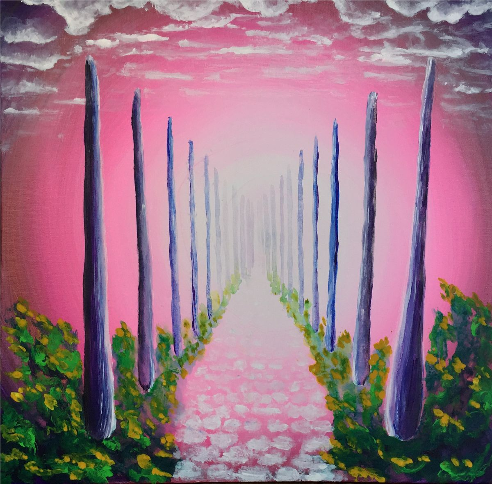

# **IGEN**

oder: **Die wundersamen Begebenheiten einer Wanderschaft**

von John David Li

## Impressum

**Titel: IGEN** - oder: Die wundersamen Begebenheiten einer Wanderschaft

**Autor (Pseudonym):** John David Li  

**Entstehung:** 1994

**Verantwortlich für den Original-Inhalt:** 
Roland Lindenbauer  
Erlkamerstr. 2a 
D-83607 Holzkirchen

**Kontakt:** 1tinker7bell (at ) gmail.com

**Urheberrecht:** © 2026 Roland Lindenbauer

**Lizenzhinweis:** 
Dieses Werk mit dem Titel "IGEN oder: Die wundersamen Begebenheiten einer Wanderschaft" von John David Li ist lizenziert unter einer Creative Commons Namensnennung 4.0 International Lizenz (CC BY 4.0).  
Lizenztext einsehbar unter: [https://creativecommons.org/licenses/by/4.0/deed.de](https://creativecommons.org/licenses/by/4.0/deed.de)

**Ergänzender Hinweis des Autors:** 
Ich begrüße und erlaube ausdrücklich Übersetzungen, Fortsetzungen, rein korrigierende Eingriffe (jedoch der rhythmische Romantext selbst muss als integraler Bestandteil im metrischen Versmaß verbleiben) sowie die kommerzielle Nutzung dieses Textes.

**Bildnachweis:** Das Gemälde ist ein Original des Autors.

## Vorwort

**Original-Quelle des Werkes:**  
Das Original dieses Romans sowie Updates und Rohdaten sind unter der folgenden Adresse abrufbar beim Open-Source-Projektarchiv (GitHub Repository): [https://github.com/JohnDavidLi/Igen](https://github.com/JohnDavidLi/Igen)

Da es sich bei diesem Roman um ein episches Werk handelt, sind Sprachverlauf und Satzstellung dem Rhythmus (durchwegs Jambus und Trochäus) angepasst. Die erste Hebung (Betonung) einer Zeile der vierhebigen Verse in Terzinen-Struktur ist in der pdf-Datei hellgrün hinterlegt.

Gelegentlich schlägt mein Dialekt durch (z. B. "ob" für "über/gegen" oder "mal" für "einmal"). Redewendungen in umgekehrter Reihenfolge oder gedankliche Einschübe zwischen Bindestrichen dienen ebenfalls der Einfügbarkeit in das Versmaß.

Tiervergleiche sind rein allegorisch im Sinne des Zeitgeistes zu verstehen und keine Verunglimpfung der Spezies. Die Charaktere sind bewusst als offen und zugänglich geschildert; die Geschichte spielt nicht in unserer Zeit, auch wenn Anspielungen auf sie vorkommen.

Zwar ist jedes Kapitel in sich abgeschlossen, doch mein Bestreben war es, durch ein Lesen im Fluss eine bestimmte Frequenz im Herzen zu aktivieren. Die bildreiche Sprache soll das analoge Denkvermögen stärken. Den Wahrheitsgehalt muss jeder für sich selbst prüfen.

**Besondere Zeichensetzung nicht ausgesprochener Satzteile:**

´ : nicht gesprochener Vokal bzw. Zwielaut
 
' : Artikel bzw. dessen Teil
 
^ : Wortendung
 
² : dass
 
³ : als
 
~ : auch wenn
 
° : Fürwörter (*ich, Du, er, sie, es, wir, Ihr, sie, man*)
 
= : Verbform von "sein" oder "werden"
 
.+ : Verbform von "haben"

*München, im Sommer 1994 (Überarbeitet 2026) 
John David Li*

## Widmung

Ohne die Vision einer "Dorfgemeinschaft Igen" 
wäre dieses Buch nicht begonnen worden,

und ohne die inspirierenden Werke von Mabel Collins 
wäre es nicht fortgeführt worden.  

Gewidmet allen Menschen 
die hoffentlich einige Weisheiten darin entdecken.

Meine Schreibkunst reicht nicht weiter, 
als mein Auge zu blicken vermag.

---

*Ehe die Augen sehen können, 
dürfen sie der Tränen nicht mehr fähig sein.*

*Ehe das Ohr hören kann, 
muss es seine Empfindlichkeit verloren haben.*

*Ehe die Stimme in Gegenwart der Meister sprechen kann, 
muss sie die Macht verloren haben zu verwunden.*

*Ehe die Seele in Gegenwart der Meister stehen kann, 
müssen ihre Füße im Blute des Herzens gewaschen sein.*

*( Mabel Collins )*

## Kapitel I

Leise weht vom Kirchturm her
 
der Glocken Klang, - zur Mittagsstund´;
 
ihr zart^ Getön erfreut uns sehr.

Ist doch in der Lande Rund´
 
dies das einz´ge baulich´ Werk,
 
das gibt aus alten Zeiten kund.

Blickt man in die Gegend, - merk -,
 
= die Häuser, ° will sie mal so nennen,
 
strahlend schön aus inn´rer Stärk´

gebildet, ich kann kaum erkennen,
 
was Architekt^, Kristall und Pflanz´ =.
 
Südwärts Sonnenstrahlen brennen

ihren eig´nen farb´gen Tanz
 
über Prismen, Kugeln, Flächen,
 
erstrahlend wunderbar im Glanz.

In die Luft die Türmchen stechen,
 
um ins Inn´re, gar zur Wonne,
 
all die Lichterfüll´ zu brechen.

In dieser Pracht der Mensch nun wohne,
 
vereint mit Tieren, Blumen, Bäume^,
 
inspiriert durch Gottes Sonne.

Drin^ und draußen - = gleiche Räume,
 
der Unterschied ist nur ein Schein;
 
°= 'n Palast für überird´sche Träume.

Hier besteht kein trennend^ Sein
 
zwischen Mensch und der Natur;
 
°= Verbundenheit durchwegs ganz rein.

° Siehst vom Bau fast keine Spur;
 
Arbeitsplätz´ = im holden Garten:
 
gebräuchlich ist hier diese Tour.

Beruf = betrieben unter'm zarten
 
leuchtend^ Schimmer, - 'n freudvoll^ Treiben,
 
find´ ich, wird man hier erwarten.

Tags zu werken zwischen Eiben,
 
nachts dann schlafen unter Rosen,
 
so würd´ ich all das umschreiben,

Flora, Fauna zu liebkosen,
 
und doch geschützt im gläsern^ Schloss =,
 
wenn draußen stürmisch´ Wasser tosen.

Vögel zwitschern auf 'nem Spross,
 
Kinder spielen Ringelrei,
 
und jeder ist sein eig´ner Boss.

Felder bilden eine Reih´
 
zwischen ' Wohnburg und dem Wald,
 
und jedermann ist hier so frei,

zu pflanzen Schönheit auf jed´ Hald´,
 
oder nützlich´ Sach^ für's Dorf;
 
gemeinsam ernten sie´s alsbald.

Heidekraut gedeiht im Torf,
 
°= 'n geliebter Platz für manche Kunst:
 
Musik erklingt beizeit^ von »Orff«,

auf Bilder wird gebannt der Dunst,
 
die Stein´ ersteh´n zu neuen Formen;
 
es wird erstrebt der Musen Gunst.

Auch Wissenschaft hält sich an Normen,
 
gewinnt der Ethik ab die Hürde:
 
lebensspendend all´s zu formen.

Jeder hier nimmt gern die Bürde,
 
für allgemeines Wohl zu sorgen;
 
alt zu sein gleicht einer Würde,

zu erkennen Schritt´ für's Morgen.
 
Reichtum ist wohl nicht vonnöten,
 
kann man sich doch alles borgen;

° darf auch fragen ohn´ Erröten,
 
was ein´m sehr am Herzen liegt;
 
drum Paare zwanglos liebend flöten.

Ich weiß nicht, was hier stärker wiegt:
 
Weisheit, Liebe, Wahrheit, Pflicht?
 
Jedenfalls die Seele fliegt,

grenzenlos ohn´ ird^ Gewicht,
 
durchgeistigt ein in hoh´ Gefielde,
 
-- neue Ziele = schon in Sicht.

Rundherum herrscht eine Milde,
 
°= durchzogen von der Freundlichkeit
 
der Bauern, Wand´rer und der Gilde.

Irgendwann gab´s mal 'ne Zeit,
 
es ist schon sehr, sehr lange her,
 
da fand sich die Gelegenheit,

-- vom Beben = alles wüst und leer,
 
nachdem die Kriege endlich aus = -,
 
gemeinschaftlich durch Arbeit schwer

zu gründen ein verbunden^ Haus,
 
-- nach 'nem Vorbild, das bekannt = -,
 
um eifrig zu studier´n, woraus

-- damit das Üble nun gebannt = -
 
die Harmonie im Staat ersteht.
 
Seitdem ward viel Gesund^ genannt,

auch von Gott oft Hilf´ erfleht,
 
sodass dies Dorf sich neu erbaut´;
 
und wie sich das Geschick oft dreht,

so wurd´ der Mensch nundenn getraut
 
als voller Teil der geistig^ Welt,
 
-- und sieh Dich um -, welch hoher Laut

die vielen Seelen nun erhellt!
 
Welch wunderbare Werk´ sie schaffen,
 
was alles einen Wert erhält.

Nimmer spiel´n sie irre Affen,
 
welche denken nur an sich;
 
auch find´st Du nirgendwo hier Waffen,

erzeugt, um zu bedrohen Dich.
 
Die Freiheit hat hier keine Grenze.
 
Es ist egal, das sehe ich,

ob wenig´ oder viele Lenze
 
auf den einzeln^ Körpern ruh´n,
 
all´ gestalten ihre Tänze

im einfach^ gegenwärt´gen Tun,
 
aus dem Inner´n rausgeboren.
 
Durch Denken, Handeln, Schau´n im Nun

wird große Freud´ heraufbeschworen,
 
denn durch die Lieb´, die all´ verbindet,
 
fühlt sich keine Seel´ verloren;

das Bewusstsein überwindet
 
Empfindungen, getrennt zu sein,
 
und im Kreis mit ander´n findet

es den eig´nen heil´gen Schrein.
 
Das Ziel, die Freude zu vermehren,
 
ist berauschender als Wein,

denn nur für sich all´s zu begehren
 
würde Lust und Herzen rauben.
 
Niemand muss die Lieb´ entbehren,

die er braucht, sich hochzuschrauben,
 
denn ohne Furcht gibt´s kein Vergeh´n;
 
-- Verständnislosigkeit von Tauben,

inn´re Nöte anzuseh´n,
 
kann aufgrund der großen Liebe
 
in diesem Staate nicht besteh´n.

So lebt man hier ganz frei ohn´ Diebe,
 
offen ist nicht nur das Herz;
 
nirgendwo gibt´s harte Hiebe,

dass man sich verzehrt vor Schmerz.
 
Jeder denkt hier an den Ander´n,
 
rücksichtsvoll, schwingt wie 'ne Terz;

auch die, die zwischen Dörfern wandern,
 
sind gern geseh´ner Freund und Gast.
 
Macht gleich ungezähmten Panthern

verwandelt sich in Tat ohn´ Hast,
 
denn Lieb´ bringt Freud´, und Freud´ gibt Kraft;
 
° erklettert so den hohen Mast

-- geholfen wird, falls wer erschlafft -
 
in unbekannten Freiraum rein.
 
Derart man sich ' Himmel schafft.

Zwischen Märkten, still im Hain,
 
herrscht reger Austausch und Verkehr;
 
die Welten sind verwoben fein.

## Kapitel II

Ich beginn´ nun die Geschicht´,
 
sie handelt von dem jungen Tom:
 
er untersucht Vergissmeinnicht,

sachte im kristall´nen Dom,
 
der heut´ als Unt´richtsstätte dient.
 
Ein alter Mann bewirkt den Strom

des Wissens, all die Kräfte lind
 
in unser´n Pflanzen zu versteh´n.
 
Und weil schon Mittag ist: - geschwind

beeil´n sich Kinder viel´ zu geh´n;
 
gibt´s doch mehr zu lernen noch,
 
zu spielen, hör´n, und Dinge seh´n.

Doch Tom bleibt schon die ganze Woch´,
 
-- die ander´n Meister stimmten zu,
 
int´ressant ist's Thema doch -,

zu erfahr´n das Pflanzen-Du
 
durch Forschen, Fühlen, Meditier´n;
 
die Zeit verfliegt dabei im Nu.

G´rad´ zermartert er sein Hirn,
 
osmotisch´ Vorgäng´ zu begreifen,
 
da zieht er kraus die hohe Stirn,

-- hört er doch im Park wen pfeifen;
 
ein uralt^ Wand´rer ist gekommen,
 
dessen Haar´ den Boden streifen.

Gleich hat Tom die Trepp´ erklommen,
 
die zum Sitzungsraume führt,
 
bereit, zu lauschen diesem frommen

Mensch, dem Achtsamkeit gebührt.
 
Wohlbekannt wohl seinem Lehrer,
 
-- °= eng umarmt -, das wird gespürt,

wartet Tom auf Kunde derer,
 
die in fernen Landen weilen.
 
Vorerst noch ein brav^ Verzehrer,

-- nach den endlos langen Meilen -,
 
von gutem Trank und stärkend^ Speis´,
 
vermag den Hund der Pilger heilen,

der schon ist vom Alter weiß.
 
Dann kommt allgemeine Sach´:
 
ein Lehrling mit Verstand und Fleiß

will lernen unter diesem Dach,
 
-- noch ist er beim Großen Rat -,
 
denn Botanik ist sein Fach,

-- und er um gute Meister bat,
 
die in seinem Dorfe fehlen.
 
° So die Reis´ mit ihm nun tat

zu Fuß, ° wollt´ nicht die Flugplatt´ wählen.
 
Von dort der Alt´ bringt Kleider mit,
 
-- es ist unmöglich zu verhehlen:

°= auserlesen schön im Schnitt
 
und ' unvergleichlich´ Qualität;
 
er tut dies mit einer Bitt´:

dass sein´n Karren man belädt
 
mit exquisiten Pflanzensamen
 
und für'n Garten best^ Gerät;

-- berühmt ist's Dorf hierfür mit Namen.
 
Endlich, Tom's Gefühle fliegen,
 
-- das vorher war ja nur der Rahmen -,

erzählt der Pilger alt´ gediegen
 
von seiner Wanderschaft zur Quell´,
 
-- einem Ort mit Namen »Igen« -,

das damals war das Vorbild hell,
 
gemeinschaftlich zu handeln, denken.
 
»Es ist«, so spricht er: »eine Stell´,

wo sie's Weltenschicksal lenken.
 
Das Gebäude = weiß, uralt;
 
Mancher würd´ den Blick heut´ senken

vor dem Haus aus Ziegel kalt^,
 
aus Scham, nichts Bess´res ° konnt´ erbau´n.
 
Doch ist dies nur die Erd-Gestalt.

Ist man drin, - welch Wunder = - staun´!
 
Finden wirst ° ein Kraftfeld vor,
 
die höchsten Eb´nen zu erschau´n.

Es bildet jetzt ein großes Tor,
 
-- ganz allmählich ist´s entstanden -,
 
mitzuspiel´n im himmlisch^ Chor.

Als sich damals Leute fanden,
 
dieses Zentrum zu errichten,
 
konnten sie´s nur tun anhanden

einer Vision, zu lichten
 
der Erde düster^ Ungemach.
 
Die Gemeinschaft war mitnichten

bestrebt, der Welt zu bieten Schach,
 
was nied´re Sphären dort betraf;
 
zu sammeln Wissen unter'm Dach,

wenn die Menschheit wie ein Schaf
 
falschen Zielen nachläuft dumm;
 
zu erlösen aus dem Schlaf

verzweifelt´ Blinde, taub und stumm;
 
zu begründen eine Kraft,
 
die im Menschen - gar nicht krumm -

Transformationen schafft,
 
die ' seelisch´ Energie beschützt,
 
wenn sie befreit aus ird´scher Haft =.

So ward die Lieb´ dazu benützt,
 
in vielen Ländern, - wie hier auch -,
 
zu schaffen Orte Geist-gestützt.«

Bei diesen Worten schwebt ein Hauch
 
von göttlich^ Energie im Raum,
 
wie ein all´s beschützend^ Strauch.

Der Wand´rer wieder spricht: »Der Traum,
 
bewusst sich selbst mal zu vollenden,
 
zerplatzt dort nicht so wie der Schaum;

die Bewohner helfen wenden
 
Deine tugendlosen Saiten;
 
gehst Du wieder fort: - sie senden

ihre Kräfte durch die Weiten,
 
um Dich allseits zu berühren
 
an bösen Orten, schlechten Zeiten,

damit Dich diese nicht verführen,
 
die dunkle Seite anzunehmen.«
 
Ungewöhnlich krank´ Allüren

bilden dann die großen Themen,
 
denn nicht nur hochentwickelt´ Länder =,
 
auch viele unbarmherzig´ Schemen

bilden immer noch die Ränder,
 
die der Mensch, der geht zu Fuß,
 
-- handelnd achtsam, wo ein Blender = -,

mühevoll durchschreiten muss.
 
Dann gibt´s noch die Dämmerzonen,
 
die oft eine harte Nuss =,

denn liebe Leute in ihr wohnen,
 
jedoch Ideen grundfalsch sie haben.
 
Zum Schluss will noch der Alt´ belohnen

-- soviel Achtung sie ihm gaben -
 
die beiden, dass sie sich wohldenn
 
an Igen's Vorzüg^ könnten laben,

° erzählt, wie dort man schult im Zen.
 
Der Tom würd´ gern noch vieles wissen:
 
wie, warum und wer und wenn;

doch die ander´n suchen Kissen;
 
es ist schon spät, - fast Mitternacht.
 
Nur noch Tom's Gedanken fliegen,

-- den Körper +° um den Schlaf gebracht -,
 
wie das wäre, wenn auch er
 
wandert´ um die Welt bedacht.

Dieser Wunsch gefällt ihm sehr;
 
was muss man alles können, machen?
 
Zuerst mal jedenfalls die Lehr´,

auch braucht er sicher fremde Sprachen;
 
weiters Training für das wilde,
 
weite Land, dazu die Sachen;

' solcher Plan auf seinem Schilde
 
macht ihm Herz und Körper licht.
 
Jahre braucht´s, zu tun dies Bilde.

## Kapitel III

Sein Entschluss, dorthin zu reisen,
 
war sein weit´rer Lebenszweck.
 
Die Gedanken um ihn kreisen,

wie wohl wird der große Treck.
 
Bereit zu steh´n vor'm Großen Rat,
 
-- das Herz auf seinem rechten Fleck -,

der letzthin die Entscheidung hat,
 
ob geschult er ist zu gehen
 
auf der Welten schmalem Grat,

wenn schier astrale Winde wehen;
 
ob er fähig, standhaft bleibt,
 
das rechte Licht dort zu erspähen,

wo Dunkelheit sein Unding treibt;
 
ob Herzlichkeit sein´n Weg bestimmt,
 
wenn Sand in off´nen Wunden reibt.

Vor'm inner´n Auge nun vernimmt
 
Tom nochmals seine wicht´gen Schritte,
 
-- zu schau´n denn, ob auch alles stimmt -,

bevor er vorträgt seine Bitte,
 
seinen Wunsch und auch sein Ziel.
 
Von Margret lernt´ er fremde Sitte,

deren Zahl gibt´s sehr, sehr viel;
 
und da nicht üb´rall Einheitssprach´ =:
 
wählte °, welche leicht ihm fiel.

Unterscheidungskunst als Fach,
 
das war in seiner Schulzeit schwer;
 
beizeiten immer wieder brach,

~ bemühte er sich noch so sehr -,
 
sein Wissen drum, was rechtens ist,
 
bei Fragestellungen nun, wer

durchwegs den richt´gen Wert beimisst
 
verschied´ner Lösung, die geboten =,
 
auf Probleme, schlaue List.

Umherzugeh´n auf samt´nen Pfoten,
 
die Wildnis ohn´ jed^ Laut durchstreifen,
 
-- hier gab´s allzeit gute Noten.

D´rum konnt´ er sich auch nicht verkneifen,
 
das Blindentraining zu verlängern,
 
um alle Sinne zu begreifen;

dazu, wie man im Umfeld enger´n
 
nur mit Riechen, Tasten lebt.
 
Zwischendurch dann, bei den Sängern,

-- laut, sodass die Erd´ erbebt´ -,
 
lernt´ er vielerlei Balladen,
 
bei denen man »im Himmel« schwebt.

Lichtdurchtränkte Nebelschwaden
 
gut zu schaffen auf's Papier
 
-- = um vieles schwerer als zu baden

in Eiseswasser nachts um vier.
 
Auch das = von großer Wichtigkeit:
 
der gute Umgang mit dem Tier;

zu lindern Schmerzen jederzeit,
 
-- ' entstanden = durch 'ne falsche Pflege -,
 
damit sein Ursein bleibt geweiht.

Nicht nur Fauna, die so rege
 
diese uns´re Welt erkundet,
 
auch die Flora, die am Wege

hungrig^ Mägen durchaus mundet:
 
zu ergründen gibt´s bei Pflanzen,
 
-- damit das Bild ist abgerundet -:

ob genießbar sind die ganzen,
 
oder Teile giftig sind;
 
kommt sie in den Essens-Ranzen?,

oder bleibt sie steh´n im Wind,
 
falls man die Art selten trifft;
 
zu entscheiden gilt´s geschwind.

Weiters, wie man richtig schifft,
 
will man große Wasser queren;
 
und dann mit dem roten Stift

' zurückgelegten Weg kann mehren
 
auf der Karte, die man hat.
 
Alsbald wird Tom auch dort verkehren,

wo kein Plan ihm gibt 'nen Rat;
 
Geowissenschaft versteht er,
 
damit der Ort ihm künd´t die Tat.

Artistisch´ Künste, meint er, später
 
ihm als Unterstützung dienen,
 
wenn es geht um Dezimeter

bei Zielen, die ihm näher schienen.
 
° Prägt´ sich Grundzüg´ ein gemeiner
 
Kenntnis, wie das Erz aus Minen

wird durch Arbeitsabläuf´ reiner;
 
was d´raus alles wird gemacht;
 
von den Vorgäng^ fehlt ihm keiner,

den er nicht zustand´ gebracht +.
 
Aber auch die feiner´n Handwerk´
 
haben ihm sein Herz entfacht;

-- bei den Meistern = der Vermerk:
 
»Mit allen Stoffen umzugeh´n,
 
darin liegt wohl seine Stärk´.«

Dazu man dieses noch erwähn´:
 
er befasst´ sich mit Geschichte,
 
um die Werte zu versteh´n,

und die Urteil´ der Gerichte,
 
-- die Sichtweis´ aus der Weltanschauung -,
 
damit nicht allzu schwer´ Gewichte

falsch^ Benehmens führ´n zur Stauung
 
aggressiven Fühlens hin.
 
Im Gegenteil, er will ' Erbauung

gold´ner Stätten für den Sinn:
 
bewusst zu machen, was ich denk´,
 
was ich fühl´ und was ich bin.

Sein Leib gab ihm ein schön^ Geschenk:
 
die Kunst zu heilen, immerzu,
 
egal, ob´s Kopf ist od´r Gelenk;

besitzt er doch die nöt´ge Ruh´,
 
das Kranke langsam aufzuheben,
 
-- oft geschieht dies auch im Nu -,

falsche Denkweis^ aufzugeben,
 
und den Körper, ' gar so schwach =,
 
mit stärkend^ Mitteln zu beleben.

Jedoch: Gesund zu werd´n versprach
 
Tom nur in Fällen inn´ren Wissens.
 
Manche waren eine Sach´,

-- nach Befragung des Gewissens -,
 
chirurgisch´ Eingriff´ vorzunehmen;
 
er hatte nie das Pech des Missens

ärztlich^ Aufsicht als ein Schemen
 
hinter sich - ein´n Mann bei Not.
 
Schließlich lernt´ er alle Themen,

Medizin als physisch^ Bot^
 
der Hilfeleistung anzuwenden;
 
natürlich´ Dinge als ein Brot,

Leiden möglichst zu beenden.
 
Auch kann er als geschulter Mann
 
nur mit Atemtechnik wenden,

was 'n And´rer nur mit Mitteln kann.
 
Derart ins Studier´n verstrickt,
 
Tom gar seine Reif´ gewann.

Jetzt er in das Auge blickt,
 
das prüfend auf sein´m Ich verweilt;
 
er merkt, der Ratsherr ist entzückt,

je länger man sein Können peilt.
 
Scheinbar ist man hochzufrieden
 
seiner Bildung, ' gut gefeilt =;

doch man hat bisher vermieden,
 
seine Schwächen zu betrachten.
 
Trotzdem hat der Rat entschieden,

-- weil sie all´ das gleiche dachten -,
 
hinaus den Weg ihm freizugeben,
 
bis Erfahrung^ Klugheit machten.

Weise wird Tom durch das Leben;
 
wandelnd auf den Füßen leisen,
 
bewirkt °, das Licht der Welt zu heben.

## Kapitel IV

Tom sich auf den Weg nun macht,
 
° kennt die Rout´ in groben Zügen;
 
sein Wandertrieb ist ganz entfacht;

-- hätt´ er Heimweh, müsst´ er lügen.
 
Langsam nur geht es voran,
 
-- überholt von manchen Flügen

seiner Freunde -, trifft er dann
 
im weiten Umfeld seiner Gegend
 
altbekannt´ Gesichter an.

Doch letzthin, weiter sich bewegend
 
längs der Eb´nen, durch die Wälder,
 
des Nachts die Gastfreundschaft belegend,

wird er bekannt als kleiner Melder
 
von Sagen, Mythen, Märchen fein.
 
So zieht er fort durch all die Felder,

mal = Gemüse, mal = der Wein,
 
-- noch immer ohne Berge, Hügel;
 
gibt´s Abwechslung? - Fast sagt man: »Nein.«

Nur die Phantasie gibt Flügel,
 
Vertrautes wieder neu zu seh´n;
 
darum lockert er die Zügel,

wenn Menschen um Geschichten fleh´n,
 
die ihre Arbeit unterbricht,
 
sodass ganz neue Geist´ entsteh´n,

wodurch die Eintön´gkeit zerbricht.
 
Einmal ist er doch verwundert:
 
als man ihn bemerket nicht;

wie wenn er wär´ ein Mensch aus hundert,
 
-- keiner ihm Beachtung schenkt.
 
In diesem Orte man den Bund ehrt,

der des Dorfes Aufschwung lenkt.
 
Ein junger Mann steht diesem vor,
 
der viel an Wirtschaftswachstum denkt.

Wie´s der Zufall will, - bevor
 
Tom weiterwandert zu sein´m Ziel,
 
trifft den Junker er beim Moor.

»Die Zeit ist reif für's große Spiel,
 
zu mischen mit im Weltenhandel.
 
Zu gewinnen gibt es viel

durch den Infrastruktur-Wandel.
 
Sieh´ nur, was schon ist getan!
 
Man frisst mich nicht so wie 'ne Mandel,

denn brechen will ich hier die Bahn,
 
zu kontaktieren fremd´ Planeten.«
 
Fanatisch´ Augen +°, wie im Wahn,

dabei die Händ´ die Knöchel kneten.
 
Tom verbleibet ganz gelassen:
 
»Ich glaub´, ich muss mal für Dich beten;

solche Ding´ sind nicht zum Spaßen.
 
Fortschritt ist ja an sich schön,
 
doch sollt´s gescheh´n in guten Maßen.

Was ich hier seh´ sind Schmerz und Stöhn´n;
 
indessen jedermann im Ort
 
möchte, dass man ihn verwöhn´.

Sie haben nur Dein eig´nes Wort,
 
dass die Zeiten besser werden;
 
ihre Augen sehen fort

auf fremde, nicht reale Herden.
 
Nicht nach innen sieht ihr Blick,
 
d´rum leiden sie soviel´ Beschwerden,

denn im Außen sucht man's Glück.
 
Willst Du mir nicht mal erzählen,
 
was Dich führt´ zu dem Geschick,

Dich als Retter, Held zu wählen,
 
der die Zukunft hier bestimmt?«
 
Ach, des Junkers Augen fehlen

Glanz und Kraft, doch er benimmt
 
sich weiter wie ein großer Herr,
 
ganz auf »selbstbewusst« getrimmt:

»Sieh´, Du Wand´rer, bitte sehr.
 
In meinen heimatlich^ Gefielden
 
war ich alsbald in Verkehr

mit Universität^, zu bilden
 
mein Intellektuellentum.
 
° Hatt´ zu plagen mich mit wilden

Prüfungs-Forderungen, d´rum
 
studierte ich gar viele Stunden,
 
zu bedecken mich mit Ruhm.

So verbracht´ ich viele Runden,
 
-- Anerkennung war nicht rar -;
 
° hab´ den Arbeitsplatz gefunden,

der wohl mein´ Bestimmung war.
 
° Bin gar mehr gefragt als and´re
 
Ratsherrn aus der alten Schar.

Wie mein Wort man wend´ und dreh´,
 
Tatsach´ bleibt: ich bin der Boss;
 
auch wenn ich mal wo anders wand´re,

um meinen Namen als 'nen Spross
 
ad´lig rein´n Geblüt´s zu schildern.«
 
»Zu hoch sitzt Du auf Deinem Ross;

wenn ich mal sprech´ in bunten Bildern:
 
die langen Arme, großen Hände,
 
üb´rall greifend, musst Du mildern;

wenn sich Dein Hirn im Herz befände,
 
müsstest 's Glück Du nicht mehr suchen;
 
Dein Kampf um Wachstum käm´ zur Wende.

Willst Du ganz allein den Kuchen?
 
° Gibst den Menschen Deine Weisung
 
und hinterlässt sie als Eunuchen.

Vergeblich wartet auf die Speisung
 
Dein Herz, ' noch nicht einmal geboren =;
 
° Denkst, durch Demut, Lobespreisung

hätt´st das Leben Du verloren?
 
Größe kommt nicht aus dem Außen,
 
da musst ° in Deinem Inner´n bohren.

Schau auf Leute, die schlecht hausen:
 
besitzt wer innerlichen Frieden,
 
schreckt ihn kein´s der vielen Grausen;

Befriedigung ist ihm beschieden.«
 
Des Junkers Augen blicken ruh´los,
 
als ob sie den Kontakt vermieden:

»Ich fühle plötzlich mich ganz stuhllos,
 
so hast ° in mich hineingetroffen;
 
als ging´ ich alle Zeiten schuhlos,

und das Wesen = fast ersoffen.
 
Musik, - das ist mein alter Traum;
 
doch niemals konnte ich erhoffen,

-- der Wunsch zerplatzend wie der Schaum -,
 
-- talentlos =° -, Instrument´ zu spielen,
 
Kunst zu zeigen hier im Raum.

Ich erinn´re mich der vielen
 
heißen Red^ zuhaus´ bei mir;
 
doch meine inner´n Ziele fielen

zum Opfer einer blanken Gier,
 
als großer Mann berühmt zu sein.
 
Als Unbekannter sag´ ich´s Dir,

° schenk´ Dir ein den reinen Wein.
 
Erfüllung such´ ich in mein´m Tun,
 
° kann nichts finden, ° könnte schrei´n,

° würde gern im Frieden ruh´n.«
 
Verzweiflung spricht aus seinen Augen.
 
»Nimm als Beispiel: ›sun and moon‹.

Selten fremd´ Gedanken taugen,
 
seine Bahnen darzubringen;
 
meist den Kern sie fest auslaugen.

Willst Du Deine Kunst besingen,
 
hör´ auf Deine inn´re Stimme;
 
der Übergang wird Dir gelingen,

hängst Du Dein Herz vor Korn und Kimme.
 
Langsam sollst ° Dein´n Weg beschreiten,
 
damit der Welt Dein Tun verschwimme.

Du kannst ab jetzt Dich vorbereiten.«
 
Dann wird herzlich froh gelacht,
 
bevor Tom's Füße weitergleiten.

## Kapitel V

Hügelig die Landschaft wird,
 
mal bergauf und mal bergab;
 
Tom so seinen Weg kreiert.

° Muss untersuchen all sein´ Hab´,
 
-- barer Münzwert herrscht hier noch -,
 
' tauschenswert für eine Gab´ =.

Auf dem Markt, die ganze Woch´,
 
laut, dass klingen seine Ohren,
 
hört er Stimmen, noch und noch.

Manchmal wird ganz unverfroren
 
ein kleiner Käufer arg geneppt,
 
und auch über'n Kamm geschoren.

Tom sieht zu, wie einer schleppt
 
riesengroß´ Figur´n aus Holz,
 
dazu am Straßenpflaster steppt;

der Ausdruck zeigt dabei viel Stolz:
 
»Diese Bildwerk´, - = ganz ein Stück,
 
ohne Dübel, ohne Bolz^,

helfen Dir zu Deinem Glück.
 
Heil´ge sind´s, ' hier dargestellt =,
 
° vermögen abzuwenden Tück´

und Schande, die Dein Leben wellt.
 
Freude wird Dir offenbar,
 
alles für ein klein^ Entgelt.«

Sich fühlend wie ein Superstar,
 
' überquellend´ Lebenskraft,
 
versucht er kleinen Kindern gar,

Werke, die er selbst erschafft,
 
zu teu´ren Preisen anzudreh´n.
 
Bald eine große Menge gafft,

um diesen Menschen dort zu seh´n.
 
»Zeigt Gefühle, ach Ihr Herr´n,
 
müsst Ihr gar so hölzern steh´n?

Meine Heil´gen helfen gern,
 
die Probleme aufzulösen;
 
dann geht auch Ihr so wie ein Stern

inmitten herrlich laut^ Getösen.
 
Kauft Ihr Leute, kauft, kauft, kauft!
 
Wollt Ihr immer weiter dösen?

Und sei´s drum: so fresst und sauft!
 
Bedenkt: das Leben ist nur kurz;
 
genießt, bevor zum Tod Ihr lauft,

denn dort wartet nur der Sturz,
 
der Gram, sich nicht mehr auszudrücken.
 
Gebt der Starrheit einen Furz!«

Handelnd mit sein´n stattlich^ Stücken
 
regt er an durch frischen Geist,
 
sich nicht vor'm inner´n Drang zu drücken.

Zur Mittagszeit er Freunde weist,
 
mit ihm zu seiner Ehr´ zu feiern,
 
doch die meisten sind verreist.

Tom glaubt, hinter seinen Schleiern
 
an dem Künstler etwas nagt;
 
sollt´ auch Schlimmes drunter geiern,

er sich doch an's Forschen wagt.
 
Noch dazu wird er geladen,
 
was seinem Ziele sehr behagt.

Alsbald Tom spricht: »Deine Schwaden
 
sinnverdreh´nder Redekunst:
 
lauern drunter nicht die Maden,

die vergällen Deine Gunst,
 
lebensfroh all´s zu genießen?
 
Freud´ verfliegt so wie der Dunst,

steckst Du einmal an den Spießen,
 
Fähigkeiten zu verlieren.
 
Denkst Du nicht, ² auf Deinen Wiesen

manche Teufel danach gieren,
 
Dich samt Haar und Haut zu schlingen?
 
Noch Dich Deine Werke zieren,

doch wird dies immerzu gelingen?«
 
»Versuchst Du, mit mir anzuecken?
 
° Kannst ja einmal mit mir ringen,

und dabei die Zähne blecken.
 
Erzeugnisse von mir sind gut,
 
° brauch´ sie nimmer zu verstecken.

Unaufhörlich ist mein Mut,
 
zu verfeinern mein Talent;
 
niemals mach´ ich alten Hut,

den jedermann schon ewig kennt.
 
Aus dem Inner´n schöpfe ich,
 
wenn ein Thema in mir brennt;

dann erschaff´ ich königlich,
 
was durch jahrelange Plage
 
früher hat entwickelt sich.

Jetzt bin ich schon in der Lage,
 
ohne groß d´rauf nachzusinnen,
 
drei Skulptur´n an einem Tage

in ihre Formen zu gewinnen.«
 
»Schön - = Dein Schaffen, zweifellos;
 
es spricht direkt zu den Sinnen,

es liebkost wie eine Ros´.
 
Der Brunnen, der am Platze ist,
 
hat kein Holz, dafür viel Moos;

vom Blitz wohl einmal aufgespießt
 
steht nur eisern das Gerüst.
 
Wenn für wahre Kunst Du bist,

und Dich eine Muse küsst,
 
dann richt´s auch ohne ird^ Verdienst;
 
damit nicht alles leer und wüst =,

womit Du fast kein Geld gewinnst.«
 
»Wie hast Du dieses nur erraten?
 
Es ist mein altes Hirngespinst,

-- für das mich wohl die Götter baten -,
 
immer wollt´ ich ihn schon richten;
 
doch stetig meine Ängste nahten,

ein selbstlos^ Wirken zu vernichten.
 
Mein Geschäft wird pleite geh´n,
 
wenn alle Leute leis´ berichten,

dass sie hab´n gefunden wen,
 
der gratis Hilfeleistung gibt.«
 
Lösung heischend, wie ein Fleh´n,

sich seine Hand zu Tom hinschiebt.
 
Dieser, °+' weiter´n Lauf durchdacht:
 
»Wenn man wirklich etwas liebt,

erhält man langsam dann die Macht,
 
über seiner selbst zu siegen.
 
Das Ich verschwindet in der Nacht,

und befreite Kräfte fliegen
 
raum- und zeitlos in die Höh´;
 
° hast ' neue Dimension bestiegen.

Nicht mehr zwicken irdisch´ Flöh´,
 
die wollen Deine Gab´ besitzen;
 
bald erfasst sie eine Bö,

sodass die auseinanderspritzen,
 
wenn Du selbstvergessen weilst
 
und vertreibst die triebhaft^ Hitzen;

wenn zum Kern hin Du jetzt feilst.
 
Das Ich drängt nur zu der Begierde,
 
dadurch Du in die Welt enteilst;

verführerisch klingt Dir die Irde,
 
° versuchst gar, alles auszukosten.
 
Talent sollt´ sein Dir eine Zierde,

sonst stehst ° auf verlor´nem Posten,
 
denn wenn Du all´s erfahren willst,
 
die himmlisch^ Drahtseil´ in Dir rosten.

'Nen Auftrag aus dem Geist erhieltst °;
 
so führ´ ihn durch, ° brauchst nicht zu fragen,
 
wo der Lohn ist, - denn sonst bild´st

Dir einen schweren ird´schen Kragen.
 
Mach´ Dein Werk und achte nicht,
 
ob Dich könnten fangen Plagen;

stehst Du dereinst hell im Licht,
 
hast ° das dunkle Tor passiert.«
 
Das Künstlers Schal´ ganz sanft zerbricht.

## Kapitel VI

Weiter geht Tom durch die Weiten,
 
erfreut sich seines kleinen Glücks,
 
erblickt Naturbegebenheiten,

spricht mit Vögeln, Ziegen, Füchs^.
 
Doch einmal, als er quert 'nen Fluss,
 
-- als Vergleich kommt ihm der »Styx«,

wo ° in'n »Hades« setzst den Fuß -,
 
eine Geisterstadt ersteht,
 
Fassaden, Häuser = voller Ruß.

Wenn der Wind in Straßen weht,
 
klappert alt^ Gebälk am Weg.
 
Obwohl die Nachtstund´ ist schon spät,

hört Tom Hammer und 'ne Säg´,
 
auch Lachen klingt zu ihm herbei.
 
So betritt er einen Steg,

der ihn führt zu einer Reih´
 
gewalt´ger Monstren, bunt bemalt.
 
Zu einem Mann er spricht: »Verzeih´,

wenn ich bitte Dich um ›Halt‹;
 
jedoch der Sinn bleibt mir verborgen,
 
-- bemüht´ ich mich auch mit Gewalt -,

was dies darstellt; bis zum Morgen
 
könnt´ ich drüber nachsinnieren,
 
-- ° muss mir Hilfe von Dir borgen.«

»Bemüh´ Dich nicht, zu spekulieren.«,
 
lächelnd ° seine Zähn´ entblößt:
 
»Ich habe mit den ander´n Vieren

der Welten Uhrwerk nun gelöst.
 
Sieh nur all die vielen Räder;
 
-- gegen das Gesetz verstößt

keines dieser Teile, weder
 
Schraubenlöcher noch die Muttern,
 
weder Glasschal´ noch das Leder.

Die Zeiten wollen wir verfuttern,
 
und durch rechte Umwandlung
 
fein´ Gewebe aus ihr buttern.

Wir fünf machten diesen Sprung,
 
zu transformieren diesen Raum
 
aus dem alten Weltendung.

Das Leben scheint mir als ein Traum,
 
denn inn´re Welten hier nur zählen;
 
das Altern merken wir jetzt kaum,

konnten wir uns doch vermählen
 
mit dem eig´nen Wesenskern.
 
Keine weisen Einsicht^ fehlen

-- denn schaffen tun wir alle gern -
 
in der Einheit dieses Werkes;
 
gewidmet ist es Unser´m HErrn.«

Angesichts des ries´gen Berges
 
müllverwertend^ Maschin´rie
 
spürt Tom eines kleinen Zwerges

selbstverzehrend´ Agonie.
 
»Sagt, Ihr Männer, lebt Ihr hier
 
nur aus Eurer Phantasie?

Dass Euch treibt nicht irdisch´ Gier,
 
das kann sogar ein Blinder sehen;
 
doch auf Erden leben wir.

Ich kann´s wenden, ich kann´s drehen,
 
wenn im Dorf ich um mich blick´:
 
nirgends ganz´ Gebäude stehen;

alles ist nur ein Geflick
 
aus losen Teilen, alten Stücken.
 
Ist es wirklich Eu´r Geschick,

Früchte zwischen Schund zu pflücken?
 
Habt Ihr keine Kinder, Frauen,
 
die Ihr könntet oft beglücken?«

»Fort sind sie, seitdem wir bauen
 
an unser´m Groß-Mysterium;
 
es brachten doch nur ihre lauen

Gefühle uns´re Werte um.
 
Wasser aus dem Fluss zu holen,
 
-- als mal blieb der Brunnen stumm -,

und ' Gemeindekass´ = gestohlen,
 
war dann ihnen unerträglich;
 
so haben sie alsbald befohlen,

zu reparier´n Kaputtes täglich.
 
Doch uns´re Vision war stärker;
 
zu Hause fast nicht mehr beweglich

schafften dies wir wie Berserker;
 
° fühlten Freiheit, das zu machen,
 
°= nicht eingesperrt in einem Kerker.

Die Frauen hatten nichts zu lachen,
 
° waren auf sich selbst gestellt;
 
° packten schließlich ihre Sachen

und verließen uns´re Welt.«
 
Traurigkeit tönt aus der Stimme,
 
die Tom diesen Vortrag hält,

auf dass sie sich nicht mehr ergrimme,
 
von Lieb^ verlassen worden z´ sein.
 
Wiederkehr erhofft die Mime.

»Ihr benahmt Euch wie die Schwein´,
 
als Ihr Euren Kern erschautet;
 
die Wohnstätt´ ist ein heil´ger Hain,

den Ihr nicht gerecht bebautet.
 
° Habt Besitzgier abgelegt,
 
als ° mit Geistkraft ward betrautet;

° seid auch nicht mehr so bewegt,
 
unbedingt auf Erd^ zu wandeln.
 
Doch die Pflicht ward nicht gehegt;

° wolltet nur mit dort anbandeln,
 
wo die höchsten Geiste wohnen.
 
Hier am Boden muss man handeln,

-- denn dann nur wird man Dich belohnen -,
 
wie man selbst sich auferlegte;
 
erst am Ende wirst Du thronen

über allzu wild erregte
 
Emotionen triebgeboren´.
 
Menschen sind Euch keine Mägde,

die Ihr habet auserkoren,
 
Euch die Arbeit abzunehmen.
 
Der Fürst der Welt hat sich geschworen,

die Kraft in Euch allzeit zu lähmen,
 
wenn keine Freude Ihr erwartet.
 
Wohin auch seine Mächte kämen,

wenn Ihr jeder Leistung harrtet,
 
welche Ihr verrichten sollt,
 
die Unlust allzugern wegkarrtet,

und Allem seinen Wert beizollt.
 
Bemüht Euch, and´re zu begreifen,
 
-- falls Ihr nicht allein sein wollt -;

durch ihr Begehren an Euch z´ schleifen;
 
freudig Pflichterfüllung z´ tun.
 
Denn die Iche gerne schweifen,

engstirnig, so wie ein Huhn,
 
ohne sonst wen zu beachten,
 
in der weiten Welt herum.

Wenn die Seelen nicht entfachten,
 
ichlos ' Kosmos zu besingen,
 
und nicht den Fortschritt überwachten,

-- niemals würde es gelingen,
 
aus dem kleinen Ich heraus
 
'nen Herzensmensch^ zustand´ zu bringen.

Richte auf ein gutes Haus,
 
und teil´ die Zeit für Pflicht und Wonne;
 
bald seid Ihr beisamm^ zum Schmaus,

-- ' Familie wird Dir dann zur Sonne
 
Wird Nächstenlieb´ Dir zur Natur,
 
hebst ° mit'm Finger eine Tonne.«

Morgens, nach der Redekur,
 
die fünf Männer rundum eilen;
 
° leisten ferner einen Schwur:

nicht mehr starr in sich zu weilen,
 
wenn man braucht Betriebsamkeiten.
 
»Lasst Kontakte uns nun heilen.«

## Kapitel VII

Bergesspitzen sich erheben
 
aus lichtdurchtränkten Nebelschwaden;
 
hohem Gipfel gilt das Streben,

den Rücken +° fast schon überladen.
 
Herrlich, stehst ° zum ersten Mal
 
auf der Höh´ mit ziehend^ Waden;

die Hänge sind dort oben kahl,
 
doch Gebilde formt´ die Erde,
 
'= schöner als des Schmiedes Stahl.

Spürt man nicht das »stirb und werde«?
 
Tom, der ganz in sich vertieft =,
 
betracht´t im Tal die wilden Pferde.

Die Luft = so rein, von nichts versieft,
 
° duftet nach alpiner Würze;
 
wer dann die Last vom Buckel hievt,

erlebt in allergrößter Kürze,
 
wie man im Geist zum Himmel fliegt.
 
Fern sieht man die Gletscherstürze,

wenn der Druck Gestein besiegt;
 
und von nah die Wasserfälle,
 
wenn der Fels sich einwärts biegt.

Tom ruht an 'ner schönen Stelle,
 
wo die Wand trifft auf den Pfad;
 
sie erscheint wie eine Schwelle,

der Rundblick = fast dreihundert Grad.
 
Ein Klett´rer läuft wie eine Spinne
 
-- sein´ Füße = schneller als ein Rad -

die Felsen hoch, als wär´ die Minne
 
seines Herzens gipfelwärts.
 
Nun schon steigt er aus der Rinne,

macht zu Tom hin einen Scherz;
 
Atem holend, ausgepumpt,
 
isst er hastig seinen Sterz.

Tom, der diesmal kurz verstummt =
 
ob dessen Leistung, meint: »Berg Heil!
 
Hättest gestern Du gelumpt,

bräuchtest ° eine lange Weil´,
 
bis Du hier heroben bist.
 
Aber wie Du ohne Seil

heraufgestürmt =, die Fahne hisst,
 
das ist schon sehr bewundernswert;
 
als ob ein Gott sich mit Dir misst.«

»Mich niemand Technik hat gelehrt,
 
° hab´s mir selber beigebracht;
 
d´rum bin ich überall geehrt.

³ Vertreter einer Bergesmacht,
 
die jede Felsenwand bezwingt,
 
gewinne ich hier jede Schlacht,

bei der ein Siegespodest winkt.
 
Doch manchmal eine Furcht steigt auf,
 
dass mein Stern auch wieder sinkt;

ich weiß, es ist der Zeiten Lauf,
 
dass alles wieder niedergeht.
 
Ständig nehm´ ich schon in Kauf,

zu klettern ohne jed´s Gerät,
 
benutzend jede kleinste Spalte.
 
Mein Gefühl im Feuer brät:

von den Siegen nichts ich halte
 
zwischen meinen starken Händen;
 
da bleibt nur die nackte, kalte

Ehrung, - Freuden, die bald enden.
 
Trotzdem treibt´s mich immer wieder,
 
-- ° wüsst´ gern, wie ich könnt´ das wenden -,

als wär´ ich kleinlich, spießig, bieder,
 
zu immer größ´rer Leistung an.
 
Ich wollt´, ich könnte singen Lieder,

wie den Ehrgeiz stoppet man.«
 
Ratlos hängt die Schulter tief.
 
»Geh´ von and´rer Seite d´ran:

Erfolg ist wie ein dicker Brief,
 
-- die Adress´ = von Dir bestimmt;
 
der Segen hängt dabei nur schief,

wenn man all´s für sich einnimmt,
 
und auch durch sich nur all´s erhält.
 
Würzig ist´s, so wie das Zimt,

wenn Dir Sieg auf Sieg zufällt;
 
bedenke wohl: der große Schmerz
 
nur dann in Deiner Geistwelt gellt,

hängst Du an'n Triumph Dein Herz.
 
Zu ehren ständig seine Stätt´,
 
ist wie zu nähren eine Kerz´

nur aus seinem eig´nem Fett.
 
Physisch hast Du ja schon Stärke;
 
doch es wäre richtig nett,

gingest Du an Deine Werke,
 
ohn´ Dein´ Seel´ daran zu hängen.
 
Durchdenk´ es wohl, und auch bemerke,

wo Du getrieben bist von Zwängen,
 
die Dein Denken Dir diktiert.
 
° Säßest bald in höher´n Rängen,

hättest Du Dich nicht geziert,
 
inn´re Stärke zu entwickeln.
 
Denn ein Mensch nur dann verliert,

wenn Zeiten all´ Gewinn´ zerstückeln,
 
und das Gefühl an Teilen hängt.
 
Lass Dich nicht mehr so verwickeln,

wenn man Achtung Dir oft schenkt;
 
sonst bleibst Du dauerhaft d´nach süchtig,
 
-- das Deine weit´ren Schritte lenkt.

Lerne lieber strebsam, züchtig,
 
den Wert von Allem zu erkennen;
 
ird´sche Augenblick´ sind flüchtig,

doch im Geiste Lichter brennen,
 
--' durch selbstlos^ Dienen oft entzündet = -,
 
die man dauerhaft könnt´ nennen.

Die Gewissheit dorthin mündet,
 
jemand wohlgetan zu haben,
 
auch wenn man auf Erd^ verkündet,

dass Du handelst wie die Raben.
 
Bitte um die inn´re Kraft,
 
dass Du kannst auch and´re laben,

wenn Ehr´ und Anseh´n mal erschlafft =.
 
Wenn kein´ Gefühl´ am Handeln hangen,
 
befreit´s Dich aus der ird´schen Haft;

so nur kannst Du das erlangen,
 
was zur Himmelsfreud´ Du zählst.
 
Lass Dich nicht von Schatten fangen,

die als Lob Du Dir erwählst;
 
Anerkennung braucht nur der,
 
-- auch wenn Du Dir dies selbst verhehlst -,

welcher psychisch schwach ist sehr,
 
und der auch nicht erträgt Verlust.
 
Ich weiß, am Anfang ist es schwer,

zu schleppen gar so argen Frust;
 
-- aber Du bist doch beliebt,
 
auf Freud´ Du nicht verzichten musst.«

Seine Hand in Tom's sich schiebt,
 
Dankbarkeit = gezeigt im Druck;
 
Fröhlichkeit sich Ausdruck gibt

im Jodler, Luftsprung, gutem Schluck.
 
»Froh bin ich ob Deiner Rede,
 
° wollt´, dass es mich nimmer juck´;

lang wird´s dauern, bis ich jede
 
Ruhmsucht, Großtun hab´ erlöst.
 
Nicht mehr will ich eine Fehde

mit der Seit´, die Furcht einflößt;
 
° will d´ran wirken, dass mein Streben
 
nach inn´rer Stärke nie mehr döst.

° Könnte Unterricht hier geben
 
allen Menschen, die mir läuten;
 
ihre Kletterkunst beleben,

auf dass sie sich am Berg erfreuten;
 
ihr´ Gemüter höher heben.
 
° Muss die Einsicht nur noch deuten.«

## Kapitel VIII

Berg und Tal - der Weg geht weiter,
 
= mühsam oft, = Tom ungewohnt;
 
zum Glück ist meist das Wetter heiter,

auch manch Gewitter oben thront.
 
Am Bachlauf sieht Tom eine Maid,
 
die wohl ihre Füße schont;

erst ganz nahe merkt er's Leid:
 
verkrüppelt´ Bein´ im Wasser baden,
 
-- in dieser Höh´ 'ne Seltenheit.

Die Augen blicken schuldbeladen,
 
Tränen feucht in ihnen schwimmen;
 
° knetet sanft die kurzen Waden,

° kann ihr´n Weg wohl nicht bestimmen.
 
Tom rückt näher, will er doch
 
ihr Vertrauen ganz gewinnen;

nachdem sie in sein´ Arme kroch,
 
lindert er die physisch^ Schmerzen;
 
° versucht, zu fassen sie im Loch:

»Erzähl´, was hast Du auf dem Herzen?
 
Ich hört´ schon vieles, schütt´ Dich aus;
 
ich werd´ bestimmt nicht drüber scherzen.«

Wie 'ne graue, furchtsam´ Maus,
 
zitternd, regt sie ihre Glieder,
 
schnuppert sie aus ihrem Haus,

-- ihre Augen blicken nieder -,
 
° löst die Wand, die sie erbaut´.
 
»Ach, zurück will ich nicht wieder.

Dort drüben ist die Hütt´, ' so laut,
 
so kalt und häßlich, voll^ Gewalt =;
 
nie hab´ ich mich dort getraut,

nachdem nur strenge Stimme hallt,
 
mein Innerstes wem auszuschütten.
 
Mein Vater oft betrunken lallt;

kann er steh´n, dann will er wüten,
 
° haut um sich mit Stock und Stein,
 
° zertrampelt alle schönen Blüten.

Zorn hat er auf mein Gebein,
 
² nichts Schön´res er zuweg gebracht +;
 
auch die Ma, berauscht vom Wein,

hat mich ständig ausgelacht.
 
° Will die beiden nicht mehr seh´n;
 
° hab´ auch oft an Flucht gedacht,

voll Zweifel, diese durchzusteh´n
 
ob meiner schrecklich kurzen Beine.
 
Zerrissen hat mich all das Fleh´n,

und jeden Augenblick ich weine
 
ob der großen Einsamkeit.«
 
»Wenn ich sagte, ´s sei nur Scheine,

glaubtest °, ´s wär´ nur Narrenheit;
 
doch merkt´st Du, was dahintersteckt,
 
fühltest Du Betroffenheit.

Wenn das Aug´ in Dir erweckt =,
 
sähest Du die große Flucht,
 
an der der Schwache gerne leckt:

Alkohol für eine Sucht,
 
diese Welt nicht zu betrachten.
 
Ird´sche Härte schlägt mit Wucht

auf ihr´ Gefühle, dass sie krachten;
 
sie stürzen ihren Tempel ein,
 
den ihr´ Gedanken stets bewachten.

Stärke hast °, sonst würd´st ° nicht sein
 
noch immer unter'm Menschentum;
 
jedoch: Du musst der Welt verzeih´n,

sonst bleibt Dein Herzchen leer und stumm.«
 
»Erklär´s mir besser, was Du sagst,
 
denn sonst bleib´ ich ewig krumm.«

»Natürlich Du jetzt gierig fragst,
 
wie die Lösung ausseh´n könnt´;
 
wenn den schwier´gen Weg Du wagst,

sei der Frieden Dir vergönnt.
 
Beschwerlich =, musst Du Weh erleiden,
 
und wirst dazu auch noch verhöhnt;

° musst Dunkles von dem Guten scheiden,
 
der Pein´ger wahre Gründ´ erschau´n,
 
die sie fernhält von den Weiden

sel´gen Schwelgens ohne Zaun.
 
Flucht, scheint mir, ist Euer Thema;
 
jeder fürcht´t, er würd´ zum Clown,

und - das ist auch das Dilemma -
 
getrennt an seinen Strängen zieht.
 
Verfahren wird nach eig´nem Schema,

in die inn´re Welt man flieht;
 
Rückzug ist nicht angebracht,
 
zur Lösung soll ertön´n ein Lied.

Bereite Dich auf diese Schlacht:
 
Missständ´ aller ander´n Leute
 
zu finden in dem eig´nen Schacht;

Fehler nicht nur aus dem Heute,
 
auch die Misskläng´ früh´rer Zeiten
 
vom Erinn´rungsschatz erbeute.

Du entdeckst Gemeinsamkeiten,
 
die Du hast schon überwunden,
 
und bemerkst Gelegenheiten,

vereint, Defekt´ zu überrunden.
 
Hast Du erkannt: wir sind all´ eins, -
 
kann Verzeihung Dir auch munden.

Die Gestalt des gold´nen Hains
 
wird in Deinem Inner´n wach;
 
besitzst an Gütern Du auch kein´s

beschützt Dich doch ein himmlisch^ Dach.
 
Kämpfst Du nimmermehr darum,
 
zu ändern all die irdisch^ Sach^,

-- die Welt macht deshalb auch nicht ›Bumm‹ -,
 
dann wirst ° Dein´n eig´nen Weg beschreiten.
 
Und geh´n mal schlimme Dinge um,

sollst den Fortschritt Du bereiten
 
anstatt zu rennen gegen Wänd´:
 
dies brächt´ hervor nur Grausamkeiten.

Vergebung ist die große Wend´,
 
die Dich zu dem Frieden führt,
 
nach dem sich strecken alle Händ´.

Nur im Herzen wirst ° gekürt,
 
diese Gnade zu empfangen;
 
wird auch ird´scher Krieg geschürt,

von Deinem strahlend^ Glanze prangen
 
Banner echten Eintrachtsdenkens;
 
dies früher schon die Yogis sangen.

Achte sehr das Heil des Schenkens
 
ohne Forderung^ zu stellen;
 
und die sanfte Macht des Lenkens,

-- als Vorbild Finst´res zu erhellen.
 
Mit der Kraft in Deinem Kern
 
kannst Du die Entscheidung fällen:

zu verstehen Deine Herr´n,
 
zu verzeih´n, vielleicht zu retten,
 
dadurch weckend Deinen Stern;

oder in die Erd´ sich betten,
 
blind wie'n Wurm, und ausgesetzt
 
allem Unheil dieser Stätten.«

»Ein himmlisch^ Hauch hat mich benetzt;
 
ich werde nun nicht länger ruh´n,
 
-- sogar wenn man mich oft verletzt -,

die inner´n Augen aufzutun,
 
und die Trennung aufzulösen.
 
° Verlass´ mich nicht auf Kart^ und Run^;

° betrachte ganz genau die Bösen,
 
ohn´ 's Gemüt daran zu fesseln.
 
° Wär´ schön, ich schuf´´s zu wahren Größen.

Nun jedoch pflück´ ich die Nesseln,
 
um zu kochen eine Suppe;
 
's Wasser brodelt schon in Kesseln.«

»Behalt´ auch ruhig Deine Puppe,
 
sprich zu ihr, dann bist ° befreiter.
 
Und nimm auch alles vor die Lupe.«

## Kapitel IX

Tom geht eine Straße lang,
 
die ihn führt in eine Stadt;
 
von ferne tönt schon herrlich^ Klang,

der Verführerisches hat.
 
Die Leute strömen um ihn her:
 
mancher kaut an einem Blatt,

ein and´rer klappert mit der Scher´,
 
die an Bändern um ihn eiert;
 
es erscheint ihm wie ein Heer,

das üb´rall seine Orgien feiert,
 
und in vollem Sinnesrausch
 
gleiche Texte runterleiert.

Etwas abseits von dem Bausch
 
sitzt ein Jüngling wie verloren,
 
° kuschelt sich in weichen Flausch,

sein´ Gedanken = wohl verworren.
 
»Schöner Bruder dieser Feen,
 
hast ° den Platz hier auserkoren,

um dem Trubel zuzuseh'n?«
 
Der Bursche blickt nun fragend auf
 
und schüttelt seine lange Mähn´.

»Ein Wand´rer bist °, - nicht aus dem Hauf^
 
dieser sinnesfreud´gen Menge;
 
darum nehm´ ich es auch in Kauf,

zu erzähl´n in voller Länge.
 
Immer schon lebt´ ich im Ort,
 
in dieser altvertrauten Enge;

war´s mir doch ein guter Hort,
 
all´ Genüsse auszukosten.
 
Doch die Freude ist nun fort;

° stehe auf verlor´nem Posten,
 
-- Heiterkeit ich nicht mehr find´.
 
Meine Triebkräft´ alle rosten,

langsam werd´ ich taub und blind.
 
Früher konnt´ ich tanzen, lachen,
 
selbst als ganz, ganz kleines Kind,

und verrückte Dinge machen;
 
denn durch den Reichtum der Gemeind´
 
gibt´s für jeden alle Sachen.

Ich kenne niemand, der ein Feind =,
 
uns´re Fressgier aufzuhalten;
 
und auch keiner hier verneint,

uns´re Sinne mal mit kalten
 
elektronischen Maschinen
 
ganz genüsslich hochzuschalten.

Da saust und braust es wie die Bienen,
 
-- verändert wird auf einem Raster -,
 
Verzückung spiegelt sich auf Mienen.

Ich kenne alle Sinneslaster,
 
° hab´ schon vieles ausprobiert,
 
° braucht´ ja dafür keinen Zaster.

° Hab´ die Ohren drangsaliert
 
mit berauschendem Gesang,
 
und Maschinen konstruiert,

damit der Sex kommt gut in Gang;
 
° hab´ die meisten Frau´n verführt,
 
-- die Nächte waren ja so lang -,

° ward zum ›Säufer-king‹ gekürt,
 
das Scheißhaus um die Ecke war.
 
Im Herzen hab´ ich nie gespürt,

obwohl ich war ein großer Star,
 
dass mich irgendwas berührt´,
 
wenn im Sinnesrausch ich war.

Die Kehle ist nun zugeschnürt,
 
kein Genuss kann Freud´ entlocken;
 
ich bekomm´, was mir gebührt,

° muss ewig in der Hölle hocken.«
 
»Frohe Kunde geb´ ich Dir,
 
-- gleich haut´s Dich aus Deinen Socken -,

bereit bist Du zu geh´n von hier,
 
zu beenden dieses Treiben;
 
denn nimmer leitet Dich die Gier,

Körperlüste großzuschreiben.
 
Ein weites Feld steht Dir nun offen,
 
-- erforsch´ es nur in kleinen Scheiben -;

denn die Seel´ ist nicht ersoffen
 
in der bunten Sinneswelt.
 
Darum kannst Du wieder hoffen,

dass die Glocke Dir oft schellt,
 
welche bringt Dir himmlisch´ Freude.
 
Nicht die ird´sche Lust erhält

Dein feines Seelenreich-Gebäude;
 
Tugendlosigkeit fällt ab,
 
wie Haare bei der Gämsenräude.

Bist ° im Stoff: - es ist Dein Grab.
 
Wenn's Bewusstsein dort nur ist,
 
wo sich dreht Dein´ Geistesnab´,

die Erdvergnügen Du vergisst;
 
denn solch^ Besitz Du nun begehrst,
 
den die Zeit nie mehr auffrisst.

Wenn mit dem Geist Du einst verkehrst,
 
fühlst ° mit Allem Dich vereint;
 
die jünger´n Brüder dann belehrtst °,

was mit Liebe ist gemeint.
 
Doch vorerst einmal musst Du suchen,
 
-- mancher hat schon d´rum geweint,

und wollte diesen Weg verfluchen -,
 
wo überhaupt die Seel´ denn steckt.
 
Bevor Du bäckst Dir einen Kuchen

vom Streben, das in Dir erweckt =,
 
brauchst Du Unterscheidungsgeist,
 
was den Körper Dir befleckt,

oder göttlich´ Gnad´ verheißt.
 
Verspürst Du Frohsein, das nicht schwindet:
 
das den ersten Schritt Dir weist;

vergänglich^ Glück jedoch Dich bindet
 
schwer an ird´ne, stofflich´ Ketten.
 
Ich hoff´, ² den Weg Dein´ Seele findet,

aus Verhaftung Dich zu retten,
 
um Dich später mit den ander´n
 
in überird´sche Reich´ zu betten.

Köstlich^ Nass aus Deinen Grandern
 
sollt´ zur Menschen-Einheit fließen;
 
Dein´ Gedanken sollten wandern

auf den spendend^, heil´gen Wiesen.
 
Nächstenlieb´ - = der erste Schritt,
 
seinen Segen auszugießen;

geleitet wird der weit´re Ritt
 
durch ein überströmend^ Herz,
 
welches jenes Sein betritt,

-- nicht berührt von ird´schem Schmerz -,
 
welches Gotteseinheit ist.«
 
Beide blicken himmelwärts;

aus dem Aug´ man Sehnsucht liest,
 
in der Seelenwelt zu weilen.
 
»'Ne Vision nun durch mich schießt;

vielleicht der Weg dorthin kann heilen.
 
Ein´n Blick, was Gnad´ ist, konnt´ ° erhaschen.«
 
»° Brauchst Dich nicht zu sehr beeilen,

sonst gießt ° ein in Deine Taschen,
 
was niedrig´ Sphär´ als ›gut‹ hinstellt.
 
Deine Laster musst Du waschen,

dass kein Dreck sich an Dir hält;
 
nimm nur das, was ewig bleibt,
 
wenn schwer Dir die Entscheidung fällt.«

»Ich wollt´, ich wär´ schon einverleibt
 
in dem Schöpfungseinheit-Bund;
 
doch die Seel´ noch in mir schweigt,

° wartet, bis der ganze Grund
 
von Geistesgütern ist bedeckt.«
 
Hoffnungsvoll ob diesem Fund,

der Lebensfunk´ = in ihm geweckt,
 
stimmt er an 'nen alt^ Gesang,
 
der voller Liebe, Weisheit steckt.

## Kapitel X

Ob schlapp und müd´ oder genesen,
 
zu wandern auf den langen Straßen
 
wurde Tom zum zweiten Wesen.

Er freut sich über jeden Rasen,
 
wo er machen kann 'ne Pause,
 
zu beseh´n die Welt mit Maßen

und stärken sich mit guter Jause.
 
Pfeifend ein schön´s Marschlied singend,
 
lädt man ihn nun gar ins Hause

eines reichen Mann´s, der, schwingend
 
in sich selbst, behaglich lebt.
 
»Ach, wie lieb´ ich diese klingend^

Melodien, mein Herz erbebt;
 
in schöne, höhere Gefielde
 
mein Trachten, Sinnen, Denken strebt.

Als Vorsteher 'ner großen Gilde
 
finde ich genügend Muße,
 
um auf's Glanzlicht, das so milde =,

ohn´ Askese, ohne Buße,
 
auf Himmelswelten zuzugeh´n.
 
Meistens nicht mit eig´nem Fuße,

-- denn das selber durchzusteh´n,
 
da verlör´ ich jede Wette.
 
Aber Glücksgefühle weh´n

auch durch technische Geräte,
 
die mich in den Zustand heben,
 
zu erschein´n auf himmlisch^ Fete.

° Brauch´ nur was vom Reichtum geben,
 
gemütlich hier vom Zimmer aus,
 
schon kann ich die Freud´ erleben,

einen überird´schen Schmaus.
 
° Kannst es ja mal selbst probieren,
 
-- ° will Dir setzen keine Flaus´;

wonniglich kannst Du spazieren
 
in die höchsten Eb´nen h´nauf.
 
Und das wird Dich int´ressieren:

alles nahm so seinen Lauf,
 
weil das Beste wollt´ ich finden
 
aus den riesengroßen Hauf^,

die sich hin zum Himmel winden.
 
° Hab´ gar manches mal versucht,
 
-- nimmer will ich mich mehr schinden;

diese allzuschwere Zucht:
 
° konnte keine Freud´ gewinnen,
 
° hab´ die Wege all´ verflucht.

Sollt´ ich hundert Jahr´ d´rauf sinnen,
 
was der Buddha wirklich ist?
 
Oder ständig nur zu dienen,

bis wer meine Hand auffrisst?
 
Ständig nur den ander´n helfen,
 
bis man selbst sich ganz vergisst?

Wir sind unter lauter Wölfen,
 
die Dir nehmen Stück für Stück;
 
es beschränkt sich nicht auf zwölfen,

abertausend woll´n Dein Glück.
 
Darum ich selbst die Menschen such´,
 
dann in deren Hand ich drück´

gute Gab´ aus meinem Tuch.
 
Bequem in meinem Sessel sitzend
 
kann ich füllen nun mein Buch,

-- ohn´ am ganzen Körper schwitzend -,
 
das verzeichnet geistig´ Wonn´.
 
Kleinigkeiten viel verspritzend

geh´ ich ein in eine Sonn´,
 
schöngewebt von einem Garn,
 
das ich selber hab´ gesponn^.

Mein Ziel ist es, mich selbst zu schar´n
 
mit den Heil´gen aller Zeit;
 
und auch freudvoll mich zu paar´n

mit Engeln oder Wesenheiten,
 
die im Reiche Gottes schweben.
 
So bewirk´ ich seelisch´ Weiten,

kann´s nicht Schöneres hier geben?«
 
Verzückt, verträumt die Augen scheinen,
 
den Blick zur Innenwelt sie heben;

vergessen haben sie das Weinen;
 
° blicken nur noch auf das Meer,
 
in welchem Gott wohnt und die Seinen.

»Dein trachtend^ Sein in aller Ehr´,
 
ich hoff´, Du wirst mir das verzeih´n:
 
vor Deiner Tür den Schmutz ich kehr´.

Du bist am Weg? - Es ist nur Schein;
 
die Trägheit hält Dich gar zu fest.
 
Du blickst zuviel auf Dein Gebein;

›Nicht bestanden‹ steht im Test.
 
Wohl hast ° Dir groß´ Verdienst erworben,
 
dass Du führst 'ne reine West´;

doch der Weg ist Dir verdorben
 
durch das Ziel, das ständig leuchtet.
 
Wär´ der Blick dorthin gestorben,

und wenn Ihr den Trug verscheuchtet,
 
-- Ihr, die ° so bequem verharrt -,
 
dass Ihr äuß´re Mittel bräuchtet, -

° wärt dann nicht so sehr erstarrt,
 
dass Almos^ geben alles sei,
 
und dadurch ins Selbst vernarrt.

Im Gegenteil: es hängt wie Blei
 
an Euren allzumüden Gliedern,
 
wenn Ihr´s gebt mit einem Schrei

nach wunderschönen himmlisch^ Liedern.
 
Wohl habt ° den ersten Schritt getan,
 
von Oben wird man ihn erwidern;

doch steiler geht der Weg bergan.
 
Nur mit großer inn´rer Stärke
 
kommt der Wandersmann voran,

° geht ohne Vorstellung zu Werke,
 
wie das Ende ausseh´n kann.
 
° Macht sich nur ein paar Vermerke,

wo er fürchtet einen Bann;
 
° weiß, ² das Ziel schon auf ihn wartet,
 
° fragt nicht ›was‹ und auch nicht ›wann‹.

Wenn Ihr Euren Mist wegkarrtet,
 
der den Körper macht so träg´;
 
wenn Ihr dann den Pfad aufscharrtet,

-- ' unsichtbar ohn´ jede Pfleg´ = -,
 
damit der Fuß auch passt ins Filz,
 
welches überwächst den Weg,

dann erst fändet Ihr den Pilz,
 
der zu sel´gem Leben führt.
 
Gleichklang zwischen Hirn und Milz

hast Du bisher nur gespürt;
 
° hast die Spur, die vor Dir liegt,
 
mit den Zehen nur berührt.

Wenn auch sehr viel Zeit verfliegt,
 
bis die ersten Schritt´ Du wagst,
 
solang Bequemheit in Dir siegt,

Du kein Wesen überragst.
 
Du hast g´rad´ einen schweren Stand,
 
-- auch wenn Du das nicht hören magst -,

denn balanzierend nah beim Rand,
 
wo Dunkelheit das Licht verschlingt,
 
brauchst Du eine weisend´ Hand,

damit der Weitergang gelingt:
 
behaglich sich zurückzulehnen -
 
nur die Stumpfheit in Dich bringt;

sich im Engelreich zu wähnen, -
 
Stillstand in Dir selbst verursacht;
 
die Augen bis zum Ziel ausz´dehnen, -

blind für'n weiter´n Weg Dich macht.
 
Schau nicht immer auf Dein´n Lohn
 
und betritt den Pfad ganz sacht.

Nur so wirst Du zum Gottessohn,
 
der in Herzen kann dann lesen.«
 
Nach dieser Red´ die Schatten floh´n.

## Kapitel XI

Die Bäum´ bewundernd und den Bach,
 
Tom nun wieder weiterzieht,
 
° ruht unter immergrünem Dach;

° besieht sich als das Bindeglied
 
zwischen Geist und der Natur,
 
die bisher die Erkenntnis mied.

Ein Lebenslied er singt, - B-Dur -,
 
allen Pflanzen und auch Tieren,
 
damit sie hör´n 'ne Weisheit pur,

nicht immer dumm vor sich hinstieren;
 
damit auch ihre Geisteskräft´
 
irgendwann mal eskalieren.

Während er noch ruhig schläft,
 
kommt laut^ Gemurmel von 'ner Zung´.
 
Tom erwacht und bringt die Säft´

erstmal ordentlich in Schwung;
 
einen kahlen Kopf er sieht
 
vor einem kleinen Felsvorsprung.

»'Nen ›Guten Morgen‹ ich Dir biet´.«,
 
allso spricht 'ne Nonn´ zu ihm:
 
»Gestern ich 'ne Wurzel briet,

° hab´ sie hier auf meinem Riem^;
 
wenn Du sie mit mir nun speisest,
 
ist das äußerst legitim.

Falls den HErrn Du mit mir preisest,
 
machst Du mir 'ne große Freud´,
 
denn dadurch Du mir beweisest,

dass es gibt gar höflich´ Leut´.«
 
Nach der Speisung und Gesang
 
mit Zimbelklang und schön^ Geläut,

kommt ein klein´s Gespräch in Gang.
 
»Jahre schon in Einsamkeit
 
-- früher war mir davor bang -

hab´n mich nach und nach befreit
 
-- meinem Lehrer sei´s gedankt -
 
von der Erdenhaftigkeit.

Manchmal habe ich gewankt,
 
ob´s das Richt´ge ist für mich;
 
doch jetzt Frieden in mir prankt,

-- dies ist mir ganz wesentlich.
 
° Mach´ mir keine Sorg´ um's Wohl;
 
° ist ja nur des Körpers Schlich´,

wenn er ist noch geisteshohl,
 
das inn´re Schauen zu verblenden.
 
° Braucht´ im Winter keine Kohl´,

° hackte Eis mit meinen Händen;
 
° wirst dies alles selbst ja kennen,
 
d´rum lass ich´s mal dabei bewenden.«

»° Seh´ die Spur von Dir gar brennen,
 
so intensiv hast ° sie gelegt;
 
° will Dir keine Namen nennen,

deren Vorbild ° hast gepflegt.
 
Weißt Du, wann von dieser Stätte
 
Dir die Stund´ des Abschieds schlägt?

Denn ich fühle, fast ich wette,
 
²° hast die Aufgab´ gut bestanden,
 
abzustreifen ' irdisch´ Kette.«

»Mit dem Meister mich verbanden
 
all mein Tun und mein Gehab´;
 
leider blieben nur Girlanden

an seinem kühlen, nassen Grab.
 
Mein Gefühl ist in der Schwebe:
 
Setz´ ich fort den gleichen Trab?

Oder pflück´ ° 'ne and´re Rebe,
 
die mir neu´ Erkenntnis bringt?
 
Natürlich sag´ ich noch: ›ich lebe‹,

doch mehr Zeit im Geist verbringt
 
gar mein Bewusstsein als auf Erd^.
 
Mir die Einheitsschau gelingt:

bin ich ich oder ein Pferd?
 
° Konnt´ noch keine Antwort finden,
 
was in Zukunft tun ich werd´.«

»Du kannst der Frag´ Dich nicht entwinden,
 
° musst besehen Deine Richtung:
 
ob die Kräft´ an Erd^ Dich binden,

oder scheinen wie 'ne Dichtung,
 
das als Ziel ° Dir vorgestellt +.
 
Zentrierung, so wie eine Lichtung,

den weiter´n Weg Dir dann erhellt;
 
° musst jetzt selber dann entscheiden,
 
ob das Ende Dir gefällt.

Denn es führt zu manchem Leiden,
 
bist ° der Richtung Dir nicht klar;
 
alleingestellt musst Du vermeiden,

dass Du Dich hältst an eine Schar,
 
die blind und taub nur imitiert.
 
Bring´ der Seel´ das Opfer dar,

-- damit sie langsam kulminiert -,
 
zu prüfen alle möglich^ Wege.
 
Denn jedem ist es indiziert,

-- mancher schrittweis´, mancher rege -
 
viele Stufen zu erbauen,
 
-- gelegentlich trotz Schicksalsschläge -,

damit ° die Seele kannst erschauen
 
am Ende einer langen Treppe.
 
Dann erst kannst ° mit ihr Dich trauen,

wie die Braut mit langer Schleppe.
 
Stuf´ um Stufe musst Du legen.
 
Wenn ich als Kaufmann Menschen neppe,

werden fort sie sich bewegen;
 
ist die Stieg´ aus Luft und Rauch,
 
bringt´s Dir wahrlich keinen Segen,

-- ° landest auf des Teufels Bauch.
 
Festgefügt muss alles sein,
 
zementiert für den Gebrauch,

-- das Streben = groß, die Wünsche = klein -,
 
bildend eine weite Brücke
 
in den Menschenseelenhain.

Acht´ d´rauf, dass bleibt keine Lücke,
 
die den Fuß nur stolpern lässt;
 
d´rum nimm auch nur die guten Stücke,

zu schaffen Deine Treppe fest.
 
Eine Sprosse von der Leiter
 
bereits Du schufst zu Deinem Nest;

such´ 'ne Straße, geh´ nur weiter,
 
die nächste Aufgab´ wartet schon;
 
sei gelassen, immer heiter,

wenn erwartet Dich auch Fron.
 
Vertiefung, Forschen, auch die Hingab´,
 
selbstlos^ Dienen unter'm Hohn,

alles ist ein Zauberstab,
 
Dein´ Laster gut zu überwinden.
 
Sogar ein ganz, ganz kleiner Knab´

kann von Übeln sich entbinden.
 
Doch acht´ den Kurs, den Du einschlägst,
 
damit die Kräft´ sich dort befinden,

wohin im Geist Du Dich bewegst.«
 
»'Nen ganzen Vortrag Du mir gabst;
 
man sieht, dass Seelen Du gern hegst;

mit Deiner Red´ das Herz ° mir labst,
 
und vielleicht ein winzig^ Teilchen
 
meiner dicken Hornhaut schabst.

Ich warte noch ein kleines Weilchen,
 
bis der nächste Schritt erkannt =;
 
gern erforsch´ ich meine Veilchen,

Rosmarin und Frauenmant^;
 
-- vielleicht darin die Aufgab´ liegt,
 
dass ich werd´ mit Blum^ verwandt.

° Werd´ mal seh´n, was überwiegt
 
an diesem meinem inner´n Drang:
 
ob die Reinheit darin siegt,

oder Unsitt´ hört Gesang.
 
Ich hoff´, ich bleibe ständig wach.«
 
Beide schau´n zum Bergeshang

## Kapitel XII

Über'n Berg, erneut im Tal,
 
Tom nun eine Pause hält,
 
Wasser schöpfend aus 'ner Schal´.

Eine Stimm´ am Dorfplatz gellt:
 
»Kräutermann, so komme schnell,
 
mein Vater sonst verlässt die Welt!«

Gebettet auf 'nem weichen Fell
 
ein Unfallopfer tödlich ringt.
 
Der Kräutermann, alsgleich zur Stell´,

das nöt´ge Werkzeug mit sich bringt;
 
auch Tom hilft mit, den Mann zu heilen;
 
-- die Operation gelingt.

Danach die beiden noch verweilen,
 
zu überwachen seine Krise,
 
während Leut´ vorübereilen.

Damit Gesprächsstoff d´zwischenfließe,
 
an den ander´n Tom sich wendet:
 
»Du verbreitest göttlich´ Brise,

die den Segen niedersendet;
 
die das Kranke stark hinwegrafft,
 
und den Menschen Leben spendet.«

»Ich glaub´, Du gibst mir gut´ Gesellschaft,
 
die ihr eig´nes Urteil hat
 
und nicht gar alles wieder nachafft.

Mein Leben ist nur noch ein Schatt^,
 
° bin ein alter Mann geworden;
 
' Kräuter sammeln, Blatt für Blatt,

wird noch meine Nerven morden.
 
° Hab´ schon allzuviel erfahren,
 
° lebt´ auch mal in wilden Horden;

° muss die Lebenskraft nun sparen,
 
denn meine Zeit ist abgelaufen.
 
° Mach´ mir nichts aus irdisch^ Waren;

° wollt´ mir Göttlichkeit erkaufen
 
durch eifrig^ Streben, recht´s Bemüh´n;
 
nun, Du siehst ja diesen Haufen,

welcher auf der Weltenbühn´
 
noch immer hofft auf seine Blüte.
 
Erfahren hab´ ich Schuld und Sühn´;

doch schon jahrelang ich brüte
 
wie 'ne Henn´ am gleichen Ort;
 
verzweifelt bin ich, fast ich wüte,

ich komm´ von meinem Stand nicht fort.
 
Früher lernt´ ich allzuleicht,
 
Inn´re Schau war mir ein Sport;

nun das Wasser ist zu seicht,
 
um mir neu´ Erkenntnis z´ bringen;
 
die Wahrheit ständig vor mir weicht.

'S ist lang her, - segelt´ ich auf Schwingen,
 
die in geist´ge Höh´n mich trugen;
 
keine Schwächen mich je fingen,

keine Rückschläg´ mich je schlugen.
 
° Hab´ fast alles ausprobiert,
 
Wege, die zur Seele lugen:

anfangs hab´ ich exerziert;
 
auch Askese war nicht fremd;
 
° hab´ die Säfte extrahiert,

welche manche Tatkraft lähmt;
 
°+ den Buddhismus ganz studiert;
 
°+ alle Sinne mir gezähmt;

°+ viele Sprachen konjugiert,
 
auch die, die nicht die Menschen sprechen;
 
°+ gute Sachen konstruiert,

die dem Fortschritt Bahnen brechen;
 
° konnte manche Leut´ belehren,
 
° zeigt´ Verständnis für die Schwächen;

° versucht´ z´ ergründen mein Begehren,
 
in die Ordnung einzutreten;
 
° konnte mich ja nie beschweren,

dass mich arge Zweifel bräten;
 
° lernt´ zu sitzen, meditieren,
 
Gottesdienst sowie das Beten;

° konnt´ Naturkräft´ observieren;
 
° wusst´ Begierden gleich zu töten;
 
° hatt´ Gebiet´ zu inspizieren,

die, bedrängt von argen Nöten,
 
manchmal ° musste exorzieren;
 
° spielte Trommeln, Sitars, Flöten;

° hatt´ gar manch^ zu annulieren,
 
wo ein and´rer Mist gebaut +;
 
° konnt´ das Wissen konservieren,

wenn im Traum ich es geschaut +;
 
° hatte Mitleid mit den Wesen,
 
welche war´n in kranker Haut,

° pflegte sie, bis sie genesen =;
 
° versuchte, Wünsche zu erfüllen,
 
° bekam dafür meist nur die Spesen;

° hörte manchen Löwen brüllen,
 
der mich anschrie schonungslos;
 
° verlangte nicht nach schönen Hüllen,

dass ich daständ´ wie 'ne Ros´;
 
° wollte helfen allen Leuten,
 
dienen ganz bedingungslos;

mit aller Kraft wollt´ ich mich häuten,
 
-- ein Wissen in mir immer war.
 
Was mag es denn nur jetzt bedeuten,

dass in Höllen ich nun fahr´,
 
-- g´rad´ am Ende meines Lebens
 
der Erkenntniskraft nun bar?«

»Die Geschichte Deines Strebens
 
zeigt mir Deinen großen Dienst;
 
die große Kunst des gut^ Verwebens

früh´rer Leben Erdgespinst
 
ist Dir alsbald wohl gelungen,
 
als Du Erfolg zu haben schienst.

Wie man spricht in fremden Zungen,
 
von urzeitlich^ Erfahrung kündet,
 
-- so hast Du all das besungen,

was von vorher in Dich mündet´.
 
Wiederholung ist gar leicht
 
mit altem Wissen drin^ verbündet;

eine neue Aufgab´ eicht
 
Deine Waage, Dein Vermögen,
 
-- sie zu tun ist wie 'ne Beicht´.

Baue an Dein^ gold´nen Bögen,
 
wenn auch Ungeduld und Leiden
 
stärker noch an Dir fest zögen.

Gewissheit hast ° von Deinen Weiden,
 
dass am Weg Du richtig bist;
 
lass die Unruh´ von Dir scheiden,

auch trotz Deiner kurzen Frist,
 
die Früchte Deiner Tat zu seh´n;
 
zu großen Wert ° der Sach´ beimisst.

Was nützet Dir denn all das Fleh´n,
 
das Dich nur vom Werk abhält,
 
vor der Zeit am Ziel zu steh´n?

Niemand das so recht gefällt,
 
ohn´ Ergebnis nur zu kämpfen;
 
man fühlt sich oft nur abgestellt

in Räum´, die alle Sinne dämpfen.
 
Doch ein vorzeitig^ Genuss
 
führte nur zu Muskelkrämpfen.

Setz´ getrost nur Fuß vor Fuß;
 
ist der Prüfung End´ gekommen,
 
dann erhältst Du Deinen Kuss,

auf dass, - das Erdenhaft´ = verschwommen -,
 
Deiner Seele Knospe bricht;
 
dem Himmelsgeist wirst Du dann frommen,

wartend auf die nächste Schicht,
 
die, im Hochgefühl der Wahrheit,
 
Dein inn´res Wesen noch mehr licht´;

zu lösen eine weit´re Starrheit
 
auf dem langen Weg zum Gral.«
 
»Das klingt nicht wie eine Narrheit.«

## Kapitel XIII

Tom kommt nun in ein Gebiet,
 
welches zählt zum Weltraum-Hafen;
 
wundersames dort geschieht,

man trifft da Edelleut´ und Grafen,
 
und auch sternenfremde Wesen,
 
die die Reise über schlafen.

Am Stadtrand üb´rall steht zu lesen:
 
»Der Bezirk ist allen offen.
 
Vorsicht sei bei Trinken, Essen.

Hier wird Fremdes angetroffen.
 
Grenze für die Sternbesucher.«
 
Tom denkt: »Jetzt will ich mal hoffen,

dass hier herrscht nicht blanker Wucher,
 
und ² ich Außenweltler seh´.«
 
Schon ertönt vor ihm ein Flucher:

»Wo gibt´s hier denn weißen Schnee?
 
Diese Erdwürm^ müssen blind sein,
 
erkenn´n sie nicht den Farbensee!«

Vom Hausdach schwebt ein Haarschopf fein:
 
»Auch wenn Du große Augen hast,
 
musst Du dennoch nicht so schrei´n.«

Die beiden noch nicht ganz erfasst,
 
bemerkt Tom auf der breiten Straße
 
einen riesengroßen Kast^,

der übersteiget alle Maße.
 
Flüssigkeiten darin blubbern,
 
in der 'ne bunte Riesenblase

sich umdreht mit 'nem Wabbern, Schlubbern,
 
drückend auf gar viele Knöpfe;
 
-- ° will wohl uns´re Welt beschnuppern.

Hier gibt´s mannigfaltig´ Köpfe,
 
man kann die Vielfalt gar nicht fassen:
 
manche sind wie farb´ge Töpfe,

and´re wieder gleichen Hasen;
 
schwer ist´s, Ordnung hier zu halten
 
in den Häusern und den Gassen;

ein großer Geist muss das verwalten,
 
dass jeder findet seinen Spaß.
 
Welch erstaunliche Gestalten:

Einer untersucht das Gras,
 
ein Zweiter hüpft einhundert Meter,
 
der Dritte schüttelt eine Vas´.

Unabhängig von dem Wetter,
 
-- denn unter'm Schutzfeld alles steht -,
 
sieht man das hier als die Bretter,

auf denen sich der Kosmos dreht.
 
Tom geht weiter zur Zentrale,
 
auf dass man ihn bestimmt berät.

Dort betritt er einen Saale,
 
wo ° induktiv durch Elektronik
 
Fragment´ erfährst in einem Male.

Die Kenntnis fließt wie Milch und Honig
 
über Stern´, die sind so fern;
 
der Geruch für Tom ist tonig:

-- so viele Stoff´ den Duft verzerr´n.
 
Tage stillt er'n Wissensdurst,
 
-- ihm keine Leut´ den Weg versperr´n -,

gut gewürzt, wie eine Wurst,
 
damit Gelehrtheit allen schmeckt.
 
»Wenn Du bald Dein´n Rucksack zurrst:«,

ein alter Diener ihn wohl neckt:
 
»Vergiss Dein Hirn nicht mitzunehmen;
 
vielleicht hat´s sich derweil versteckt.

Draußen wirklich, hier ein Schemen,
 
kannst Du alles nicht erfahren;
 
deshalb brauchst Du Dich nicht grämen.«

»° Werd´ dies^ Wissen schon bewahren,
 
irgendwo in mir gespeichert
 
hilft´s vielleicht gar manchem Zaren.

Wird nicht die Welt davon bereichert,
 
wenn von Wundern man berichtet,
 
und ebenso ein and´res Reich ehrt?

Verbundenheit wird nicht vernichtet;
 
im Gegenteil: sie wächst und wächst,
 
wenn and´re Kosmen werd´n bedichtet.«

»Bisweilen ist es wie verhext:
 
nach einer Stunde mancher geht,
 
den Kopf +°, als hätte er gezecht;

und nun ein Bursche vor mir steht,
 
der wochenlang herum hier streift,
 
und mich mit Worten niedermäht;

der wohl das alles auch begreift?«
 
»Natürlich, ° wär´ ja sonst nicht hier.
 
Nicht lang genug hast ° wohl gereift;

geh mal lieber zu Dein´m Bier,
 
sonst beißt ° Dir noch die Zähne aus,
 
wenn ich die Sprache Dir verzier´.«

Damit stakst Tom aus dem Haus.
 
Die Wunder wieder ihn umfangen:
 
Leute, ' klein wie eine Maus =,

aber riesig ihre Zangen =;
 
wolkengleiche Traumgestalten
 
mit grellfarbig bemalten Wangen,

die Stirne = voller Altersfalten;
 
dicke Stäb´ im Mund sie führen,
 
darauf sie ständig drücken, schalten.

Wollt´ die Seltsamkeit man küren,
 
man wär´ sich niemals d´rüber einig;
 
° würd´ bei jedem Gast verspüren,

dass Vergleich´ sind fadenscheinig.
 
Alles kann man schauend finden:
 
hochgewachsen, tausendbeinig,

Birken, Tannen, Lärchen, Linden,
 
dick und dünn, und groß und klein;
 
alle Vorurteil´ verschwinden

ob diesem kunterbunten Sein.
 
Tom will fassen in sein Herz
 
diese viel´n verschied´nen Reih´n;

° macht auch mal 'nen fröhlich^ Scherz.
 
Niemand wird hier wehgetan,
 
egal ob Mücke oder Nerz;

man wird sonst Eigentum des Khan,
 
allso lautet das Gesetz.
 
Locker an der Sache dran,

dass er niemals wen verletz´,
 
Tom gar Jahre das studiert,
 
-- manchmal war´s 'ne lust´ge Hetz´ -,

wie das Denken von dem Wirt,
 
welcher auf der Erde weilt,
 
eigentlich denn funktioniert.

Daher er nicht mit ander´n keilt,
 
sondern ernst mit ihnen spricht:
 
wie man Körperleiden heilt;

wie sie werten das Gericht;
 
von den Welten, die so fern =;
 
wie sie wahren das Gesicht;

was sie essen, trinken gern;
 
wie sie umgeh´n mit Gewicht;
 
ob sie Page von 'nem Herrn =;

wie sie steh´n zu einer Pflicht;
 
ob sie haben Philosophen;
 
wann gewinnen sie 'ne Sicht.

Nach endlos langen, schönen Strophen
 
verschied´ner fern^ Gedankengäng´,
 
dienend, wie die Kammerzofen,

wandert Tom nun aus der Meng´,
 
sein ursprüngliches Ziel vor Augen;
 
drei Jahre zog´s sich in die Läng´.

»Du würdest hier als Werkmann taugen.«,
 
so = des Khanes Abschiedsworte:
 
»Du kennst die Säuren, kennst die Laugen,

die hier brauchet jede Sorte;
 
wenn´s Dich wieder hierherzieht:
 
kriegst ° von mir 'ne große Torte.«

## Kapitel XIV

Am nächsten Abend, ´s war schon spät,
 
um Unterkunft Tom hat gefragt;
 
vor einem alten Haus er steht:

die Fenster, Mauern sind betagt,
 
es bess´re Zeiten sicher kannt´.
 
Die Wirtin, fast sie scheint verzagt,

Farben auf 'ne Platte bannt.
 
»Auf dieses Werk, das Du hier machst,
 
bin ich nun einmal gespannt.

Mit wildem Pinselstrich entfachst
 
Du wohl ein kleines Bild aus Dir;
 
schön, wie Du dabei auch lachst.«

Der Stunden waren´s dann noch vier,
 
bevor die Arbeit ist beendet.
 
Tom, der nach 'nem kühlen Bier

sich der Künstlerin zuwendet,
 
betrachtet alles ganz genau:
 
»Das Licht im Bild mir Freude spendet,

-- und doch, wenn ich exakter schau´:
 
irgendetwas fehlt hier noch,
 
das alles wirkt ein wenig lau.

Von Lebenskraft ich nichts mehr roch;
 
´s ist wie das Wasser vom Geysir,
 
das zurückfließt in sein Loch.«

»Kannst Du sehen, wie das Hier
 
sich im inner´n Wert ausdrückt?
 
Wenn das stimmt, so hilft es mir,

zu klär´n, was mich nicht sehr beglückt:
 
früh´re Werke, die ich malt´:
 
-- alle Leute war´n entzückt.

Doch nun Schweigen hier drin hallt;
 
die Galerie bleibt stumm und leer,
 
versucht´ ich auch mal mit Gewalt,

zu bringen manche Menschen her.
 
Diese Kenntnis in mir brennt,
 
es durchbohrt mich wie ein Speer.

Ich seh´, wie Unheil zu mir rennt,
 
-- all mein Schaffen wird gelähmt.
 
Jeder mich 'ne Meist´rin nennt,

dennoch fühl´ ich mich beschämt,
 
weil nimmer Bilder ich verkaufe.
 
Dies mich allzusehr oft grämt.

Wie vom Regen in die Traufe
 
kommt der weit´re Weg mir vor.
 
Doch jetzt zeig´ ich Dir ›Die Taufe‹,

mein erst´s Gemäld´, das ich beschwor;
 
vielleicht kannst ° einen Rat mir geben,
 
dass zurück ich find´ zum Tor.«

»Die Malerei hier zeugt vom Leben,
 
wenn auch technisch unvollkommen;
 
kann es nicht was Schön´res geben,

wenn ° den Gipfel hast erklommen,
 
welcher Glück und Lieb´ ausstrahlt?
 
Neu´re Werke sind verschwommen,

Natürlichkeiten = übermalt;
 
wiederholt ist alles nur,
 
dieses macht sich nicht bezahlt.

Fließen müssen Künste pur,
 
zum König wirst Du dann gekürt;
 
ansonsten wandelst ° auf der Spur,

die zum Untergang hin führt.
 
Repetierung allzuoft
 
wird durch Hochgenuss geschürt,

welchen man in sich erhofft,
 
wenn am gleichen Punkt man steht.
 
Die Werte werden dann verzofft.

Alt^ Gewässer in 'nem Beet
 
bringt die Fäulnis nur hervor;
 
man besser immer vorwärts geht,

um mitzutun im geist´gen Chor.
 
Stetig Neues zu gestalten
 
führt Dich niemals mehr ins Moor.«

»Ich wollt´, ich könnt´ die Kräft´ entfalten,
 
auszuschreiten frisch und froh,
 
-- so wie and´re Meister malten -,

nicht mehr sitzend auf dem Klo;
 
neue Gipfel zu erstürmen,
 
and´re Eb´nen, sowieso.

Werke soll´n sich in mir türmen,
 
die ich weitergeben kann;
 
° will die Götter nicht erzürnen,

weil Verkehrtes ich ersann.
 
° Will so gerne mich vergießen,
 
wie das Wasser aus 'ner Kann´;

die Energieen mich verließen,
 
zu kämpfen um die inn´re Welt.
 
Die alten Werte mich umschließen,

was meine Seel´ gefangenhält;
 
im Schaffen fühlt´ ich früher Liebe,
 
heute wirk´ ich´s mit 'ner Kält´.«

»Beobacht´ Deine inner´n Triebe,
 
sieh dabei gelassen zu;
 
' Angst, Du könntest kriegen Hiebe,

bette in 'ne lichtvoll´ Truh´.
 
Beginn´, die Wahrheit zu verkünden,
 
-- der Krieger in Dir bist nicht Du -:

Erfahrung aus Dein´n früh´ren Sünden
 
als Weisheit in die Welt gebracht.
 
° Wirst die Herzen all´ entzünden,

die sich auf den Weg gemacht +;
 
'ne Lehre kannst Du ihnen geben,
 
wie man umgeht mit der Macht.

Erkenne erst das inn´re Streben,
 
-- eine Stimm´ ertönt in Stille -,
 
dann geh´ d´ran, die Schätz´ zu heben,

' dargereicht = wie eine Pille,
 
die ein jeder schlucken mag.
 
Stehe aufrecht in der Zille,

-- allso wie in alter Sag´ -,
 
die im Seelenmeere schwimmt.
 
Dämmert Dir das Werk vom Tag,

welches Dir ist wohl bestimmt,
 
lass es durchführ´n von dem Teil,
 
der von Dir dafür getrimmt =.

Halt´ nicht selber dieses Beil,
 
welches man zur Arbeit schwingt,
 
dann erfährst Du dieses Heil,

welches große Freude bringt.
 
Abseits stehend tust Du doch,
 
was als Tätigkeit man singt,

frohen Herzens Woch´ um Woch´,
 
als wär´n´s die engsten Wünsche Dein;
 
abgeschirmt und ohne Loch

gegen irdisch-sinnlich^ Schein,
 
wirkt durch Dich 'ne höh´re Macht,
 
die benützt nur Dein Gebein

in der ew´gen alten Schlacht.
 
Selber siehst ° der Siege viel´,
 
die, durch Dich gewirkt, entfacht =;

° erblickst Dich mitten in dem Spiel,
 
doch unberührt vom Erd-Gehab´.
 
Dein Körper ist der lange Stiel,

welcher einbricht in jed´s Grab;
 
das Bewußtsein schaut die Wonne,
 
welche ist die weise Gab´,

stehst Du in der Geistessonne.
 
Halte Ausschau nach dem Krieger
 
dass er ständig in Dir wohne,

denn nur er ist dieser Sieger,
 
der durch Dich die Macht erhält,
 
all´s zu schaffen wie der Tiger.

Die Entscheidung hast ° gefällt,
 
-- zu Geist, sonst zu Mater^ man geht -,
 
wen als Herrn Du Dir gewählt +.«

## Kapitel XV

Der weit´re Weg führt durch 'nen Park,
 
der von Menschenhand geschaffen =;
 
er erscheint Tom wie 'ne Bark´,

wo Du niemals findest Waffen.
 
All´ Geschöpfe sind vereint,
 
-- Krokodile und Giraffen -,

wo das wär´n natürlich´ Feind´,
 
sind sie durch 'nen Zaun getrennt.
 
Jeder Tod wird hier beweint,

-- an jedem Tage wird geflennt -,
 
denn Artenschutz sehr schwer ein´m fällt,
 
wenn ein Jung´s ins Unglück rennt.

'Ne blonde Frau, ' dorthin gestellt =,
 
die blauen Augen blicken klar,
 
sich mit Tom nun unterhält

über manche Themen gar:
 
»Das ist meine Aufgab´ hier,
 
° leb´ schon an die zwanzig Jahr´

in diesem schönen Wild-Revier.
 
Ich versuche zu erhalten
 
alle die verschied´nen Tier´,

diese traurigen Gestalten,
 
die sonst Opfer uns´rer Lanzen,
 
der erdumformenden Gewalten =.

° Habe hier auch selt´ne Pflanzen,
 
die an keinem Ort der Erde
 
weiter in der Sonne tanzen.

Ich seh´ hier das ›stirb und werde‹,
 
und es bekümmert mich gar sehr,
 
dass immer weiter schrumpft die Herde,

welche brachte ich hierher.
 
Ständig steht das Ziel vor´m Auge:
 
zu bewahren dieses Heer;

doch ich fürcht´, dass nichts ich tauge,
 
obwohl die inn´re Stimm´ mich leitet.
 
Es kommt mir vor wie eine Lauge,

die mein´n Wirkungskreis durchschreitet.
 
Tausend Helfer war´n schon hier,
 
° hab´ sie wieder fortbegleitet;

´s war schwer für sie der Umstand schier,
 
-- und niemand konnt´ es bislang wenden -,
 
dass die Arten, oftmals vier,

vergehen unter unser´n Händen.
 
Wenn ich nicht nach innen hört´,
 
dass mein´ Ziel´ sich recht befänden,

ich wäre sicher ganz gestört;
 
° wär´ von der Erden Ungemach
 
bis zur Unkenntnis betört.«

»Was Du machst - = 'ne gute Sach´,
 
die Natur uns zu bewahren;
 
° bist 'ne Meisterin im Fach.

Niemand könnt´ so gut verfahren;
 
wenn man keine Siege sieht,
 
trotzdem recht sich zu gebaren.

Dein Geist ist dieses Bindeglied,
 
von der Seele aus geleitet;
 
der Körper in den Kampfe zieht,

vom Bewusstsein nur begleitet.
 
Durch den langen Weg musst ° lernen,
 
warum der Tod sich so verbreitet,

-- die Tiere geh´n in weite Fernen;
 
wie: von der Erde Abschied nehmen,
 
wenn der Mensch reist zu den Sternen.

Dein Gefühl dafür musst ° zähmen,
 
was Du ständig nur verlierst;
 
vielleicht erkennst Du all die Schemen,

wenn Du Dich d´rauf konzentrierst,
 
welche hinter allem stehen.
 
Ansonsten allzusehr Du frierst,

siehst Du Arten von Dir gehen.
 
Betracht´ doch mal die and´re Seite:
 
viele Wunder gar geschehen

in ihrer völlig ganzen Breite:
 
überall entsteht nur Neues
 
in dieser großen Erdenweite;

manchmal ist es etwas Scheues,
 
das man nicht so leicht entdeckt;
 
oft auch etwas Nettes, Treues,

das die inn´re Freude weckt.
 
Wo, glaubst Du, in all den Zeiten,
 
hat sich deren Geist versteckt?

Bald erkennst ° Gemeinsamkeiten
 
zwischen Tot^ und neu Erblühten;
 
es ist der Weg der Wesenheiten,

zu wählen zwischen vielen Hüten,
 
die man ausprobieren könnte.
 
Warum denn d´rüber länger brüten,

einen Hut, der letzthin dröhnte,
 
wieder über'n Geist zu zieh´n,
 
wenn ein and´rer ihn verwöhnte?

Manch ein Schlusslicht will noch flieh´n
 
in ein altgewoht^ Gebilde,
 
das ihm nochmals besser schien,

zu erforschen sein Gefielde.
 
Bestimmt zu ihr´n Genossen stoßen
 
führ´n auch sie in ihrem Schilde.

Darum sollst weiter Du liebkosen
 
alle Art, die weiter will;
 
allein nur bei den vielen Rosen

wandelt sich doch stets der Stil;
 
der Geist durchwandert viele Formen
 
auf seinem Weg zum fernen Ziel.«

»° Dank´ Dir, ° nahmst mir etlich´ Dornen,
 
wo ° kein´ Antwort noch gefunden +;
 
betrachtet man´s mit Deinen Normen,

blickt man über größ´re Runden.
 
Dieses Beispiel passt auch gut
 
zu meinen lieben, guten Hunden.«

»Jetzt bleib´ weiter an der Glut,
 
die Erkenntnisfahn´ zu hissen;
 
eine wahre Wissensflut

wird alsbald Dein´n Geist begießen.
 
Die Gesetze der Natur,
 
-- die Arbeit sollst ° dabei genießen -,

dahinterliegend´ Kräfte, pur,
 
zu studier´n davon befreit,
 
sein Werk zu tun im Geiste stur.

Hier hast Du ja Gelegenheit,
 
Dein selig^ Schaffen fortzusetzen,
 
und wenn Dein Denken ist bereit,

mit jenem Wesen eng zu schwätzen,
 
welches das Naturreich lenkt.
 
Setz´ zusammen diese Fetzen,

die an Wissen man Dir schenkt;
 
zusamm^ erklingt die Melodie,
 
die nicht endet, nicht anfängt;

das Herz empfängt die Symphonie,
 
die den Lebensstrom bewegt.
 
Erkennen wirst ° die Harmonie,

welche all´ Bereiche pflegt;
 
° kannst die Lebenswasser schau´n,
 
und das Herz, das immer schlägt.«

»Fast mir könnte davor grau´n,
 
vor dem Weg, der vor mir liegt;
 
aber hab´ ich doch's Vertrau´n,

dass die Kenntnis in mir siegt.
 
Obwohl ° schon oft hab´ nachgedacht,
 
° hab´ das Lied noch nicht gekriegt,

welches über'm Leben wacht;
 
° muss wohl immer tiefer blicken,
 
dort in innerer Betracht^.«

»Lass Dein´n Forsch^geist weiterticken,
 
und bleib´ auch fernerhin so stark;
 
die Götter werden zu Dir nicken.«

## Kapitel XVI

Der Boden muss sehr fruchtbar sein,
 
über welchen Tom nun schreitet;
 
schwarze Erde, wilder Wein,

alles = vor ihm ausgebreitet
 
in der Felder schön^ Gefüge.
 
Dazwischen manche Schlange gleitet,

-- arbeitender Menschen Züge -,
 
um's Erdreich lieblich zu gestalten;
 
-- fein geformte Höhenflüge,

die Natur uns zu erhalten.
 
Ökologisch´ Gleichgewichte:
 
strebsam wollen sie´s verwalten.

Unter einer großen Fichte,
 
die im kleinen Orte steht,
 
ertönen Klänge, helle, lichte,

die, alsbald vom Wind verweht,
 
jedes Herzchen wohl anrühr´n.
 
Eine Frau genügsam näht,

sicher um ihr´ Freud´ zu schür´n,
 
sitzend neben einem Spielmann.
 
Sein´ Musik, das kann man spür´n,

regt die inner´n Kräfte an,
 
mit der Harmonie zu schwingen,
 
dass man's Leben finden kann.

Viele Melodien erklingen,
 
wo Natur ward eingefangen;
 
die Gemüter mit ihr singen,

ohne Zagen, ohne Bangen.
 
In den Pausen zwischendrin:
 
ein kurz^ Gespräch wird angefangen

mit viel Lachen in der Mien´;
 
Themen gibt´s dafür gar viele,
 
alles was ihm kommt in'n Sinn.

Vielfach sind es auch nur Spiele
 
-- Würfel zwischen ihnen rauschen -
 
mit dem einen großen Ziele,

sich mit Menschen auszutauschen.
 
Immer wieder Leute weilen,
 
um dem Liede fein zu lauschen;

manche sich nicht sehr beeilen,
 
zu ihrem Werk zurückzukehren;
 
and´re wandern viele Meilen,

um zu hören diesen Stern,
 
der ihnen hier so fröhlich scheint.
 
Seine Weisen sind wie Fähr´n,

damit es wird im Mensch vereint
 
die Außenwelt und Innenwelt.
 
Gelegentlich dann einer weint.

Tom zu ihm sich nun gesellt,
 
er hat´s schon lang von fern betrachtet:
 
»Ich komm´ zu Dir ins Baumeszelt,

das da wird so sehr beachtet;
 
° danke für die schönen Lieder,
 
die zu Hören Ihr mir brachtet.

° Hoffe, dass wir seh´n uns wieder,
 
zu erfreu´n mich Deines Schalles.«
 
»° Hab´ hier ständig meine Glieder,

was ich brauch´, bekomm´ ich alles:
 
Wasser, Brot, und auch ein Bett;
 
° bin der Spielmann dieses Tales.

Sicher werd´ ich hier nicht fett
 
ob der Abgeschiedenheit;
 
aber Menschen sind hier nett,

das bedeut´t mir Seligkeit.
 
° Hab´ erforscht den Lebensgeist,
 
°+ mich vom ird´schen Zwang befreit;

mein´ inn´re Melodie mich weist,
 
diese Klänge aufzuführen.
 
Das Treiben rund um mich beweist,

auch ohne Flöten oder Lyren,
 
dass irgendwas sie hierher treibt,
 
dass sie irgendetwas spüren.«

»In den Menschen ständig reibt
 
irgendeine Bitte, Not;
 
Dir nichts and´res übrigbleibt,

³ zu gucken in den engen Schlot,
 
der aus ihrem Herzen wächst.
 
Beachte diese täglich^ Bot^;

mancher gar sehr d´runter ächzt,
 
sein allzuschweres Kreuz zu tragen;
 
dieser nur nach Lösung lechzt,

ohne Dich direkt zu fragen.
 
Ich seh´ in Dir, dass Du nicht weißt,
 
was Du ihnen könntest sagen,

wie die Antwort für sie heißt;
 
hör nur zu auf die Beschwerden.
 
All ihr Sehnen darum kreist,

eine Spannung loszuwerden;
 
doch sie plappern nur drauf los,
 
so wie Schafe, Rinderherden,

und seh´n nicht in ihrem Schoß
 
den wahren Grund der inn´ren Schmerzen.
 
° Musst erschauen diesen Kloß,

welcher steckt in ihren Herzen;
 
° musst dies lange Zeit studieren,
 
bis Du entzünden kannst ihr´ Kerzen.

Die äuß´ren Red^ nur konzentrieren
 
all ihr Denken auf die Wunden;
 
das Gehirn kann nur sezieren,

der wahre Hintergrund = entschwunden.
 
Du musst in die Tiefe blicken,
 
wo Energieen noch entbunden =;

zu ihren Seelenkräften nicken,
 
auf dass sie ihr Gewirk kund tun;
 
diese Stück´ zusammenflicken,

um im friedenvollen Ruh´n
 
die Verdrehung rauszufinden,
 
die lässt handeln sie wie'n Huhn.

Abschäl´n muss man viele Rinden,
 
zu durchdringen ird´schen Schein;
 
mehr Stärk´ braucht´s, willst Du entwinden

die Verhaftung in ihr´m Sein.
 
Nach ihr´m Herzen musst Du strecken,
 
-- unpersönlich wie ein Stein -,

Deinen forschend^ Geist, zu wecken
 
das erkenntnisvolle Streben;
 
schließlich wirst Du dann entdecken,

welche Kräfte daran kleben,
 
an der Macht, die ist noch rein;
 
durch das Suhl´n in Erdengräben

entsteht dadurch die große Pein.
 
Ohne Urteil musst Du schauen,
 
damit Du siehst das Wirken rein.«

Inzwischen Kinder und auch Frauen
 
neben diesen beiden sticken.
 
»Endlich wirst Du Dich auch trauen,

an jenen geist´gen Ort zu blicken,
 
welcher in Dir selber ist.
 
Erkennen wirst Du Dein Verstricken

mit dem Leben, das Du bist,
 
wenn im tiefen Grund der Seele
 
im eig´nen Herzen Du nun liest.

Du gehorchst schon dem Befehle,
 
den die inn´re Stimm´ Dir gibt;
 
auch ertönt aus Deiner Kehle,

wie uns all´ das Leben liebt.
 
Nun erkenne diese Macht,
 
die uns Menschen treibt und schiebt;

was in uns denn ist entfacht,
 
dass trotz Leid wir weiterwühlen.
 
Lang ist dieser dunkle Schacht,

-- davon gibt´s viele, ° kannst es fühlen -,
 
der da führt zum reinen Sein.«
 
Des Baumes Schatten beide kühlen.

## Kapitel XVII

Das Land ist nun wie die Prärie,
 
welches Tom g´rad´ froh betritt;
 
die Erde ist voll Energie,

° strömt in ihn bei jedem Schritt.
 
Fällt ein wohlig warmer Regen
 
aus des Himmels Wolkenmitt´,

ist´s dem trock´nen Boden Segen:
 
alles Leben gut gedeiht;
 
° siehst die Blüten sich bewegen,

schon der Herrlichkeit geweiht;
 
köstlich^ Wasser aus den Höh´n
 
den Wesen Lebensgeist verleiht.

Momentan weht warmer Föhn,
 
-- die Luft = so klar, die Berg´ = so nah,
 
der Anblick ist gar wunderschön.

Auch ist 'ne alte Kultstätt´ da,
 
gebildet aus gar großen Steinen;
 
sowas Tom schon öfter sah.

Er hört im Zentrum jemand greinen:
 
ein kleines Mädchen, ach so zart,
 
muss den Tod des Hund´s beweinen,

in den ihr Herzchen war vernarrt.
 
'Ne Schamanin, alt und grau,
 
in ein off´nes Feuer starrt;

° öffnet sich der inner´n Schau;
 
° lehnt im Sessel sich zurück,
 
spricht mit einer Stimme, rauh:

»Dein Hund geht über eine Brück´,
 
um als Mensch zu Dir zu stoßen;
 
dauern wird´s noch gar ein Stück,

sonst es geht ihm in die Hosen.«
 
Ein´n Gesang sie d´raufhin anstimmt,
 
dass die Laute nur so tosen,

-- indianisch ist´s bestimmt,
 
von den Ahnen übernommen -,
 
bis das Feuer nur noch glimmt.

Dann auch and´re Leute kommen,
 
sie um Hilfe bald beschworen;
 
° wirken irgendwie beklommen,

aus Ängsten, Nöten rausgeboren.
 
Einer tritt aus dieser Meute,
 
setzt sich vor sie, unverfroren:

»Ich wittere hier fette Beute;
 
jeder kommt, um Rat zu suchen,
 
-- an die zwanzig sind es heute -,

ich wette, ² Du wirst nichts verbuchen,
 
was Du eingenommen hast.
 
° Willst nichts geben von dem Kuchen,

den Dein Sparstrumpf wohl umfasst.«
 
»Nichts ich hab´, und ° glaubst mir nicht,
 
nur weil Dein´ Frau viel Geld verprasst.«

Sogleich sie wendet sich vom Wicht,
 
um zu winken einem Mann,
 
der machet ein betrübt^ Gesicht.

Er kurz sein Leiden ihr vorspann,
 
erzählend von dem großen Schmerz,
 
den er selbst in seinem Wahn

trägt so schwer in seinem Herz.
 
Schamanenaugen blicken blau
 
eine Weile himmelwärts,

dann verkündet diese Frau:
 
»Deine Ängste, zu verlieren,
 
bilden diesen großen Stau.

Machst ° so weiter, kommen Viren,
 
die in Gang 'ne Lähmung setzen;
 
° kannst dann nur noch vor Dich stieren.

Verschenke doch die öden Fetzen,
 
die and´re Leute so begehren;
 
° brauchst auch gar nicht so zu hetzen,

um die Last noch zu beschweren.
 
Ruhe ist für Dich vonnöten,
 
Siege lasse starken Bären;

der Chef bezahlt Dir Deine Kröten,
 
auch wenn Du nicht der Beste bist.
 
° Musst nicht ständig um ihn flöten,

damit er Dich auch nicht vergisst.«
 
Mit Puderzucker stäubt sie ihn,
 
ein kurzer Tanz an dieses schließt,

dann verzieht sie ihre Mien´,
 
um ihn heftig auszulachen.
 
Anfangs wollte er entflieh´n,

dann lässt auch er es richtig krachen:
 
»Schön ist´s, mal Verlierer z´ sein;
 
° machst wohl immer solche Sachen?«

Weiter wirkt sie, zu befrei´n
 
manches Menschen bitt´re Not,
 
welche drücket das Gebein,

welch´ zu übermannen droht
 
jedes Fühlen und auch Denken
 
und zurücklässt jemand tot.

Stets versuchte sie zu lenken,
 
dass der Mensch mal darauf schaue,
 
wo Gedanken sich verrenken,

und darauf nun die Lösung baue,
 
um die Pein mal zu beenden.
 
Bei der Menge war´n auch Schlaue,

welche spielend konnten wenden
 
ihrer Worte Sinn für sie.
 
Sie gingen fort mit leeren Händen,

denn die Red´ erreicht´ sie nie;
 
weil der Verstand dann ihren Sätzen
 
'nen anderen Gehalt verlieh.

Die Frau gar wollte sich nicht wetzen
 
mit deren guter Spracheskunst.
 
Manch And´rer spürte arg^ Entsetzen,

entschwebend wie ein leichter Dunst,
 
ob ihrer Umschweiflosigkeit;
 
sie verscherzten sich die Gunst,

die märchenhaft´ Gelegenheit,
 
in den Tiefen mal zu loten.
 
Sie schafft so bis zur Schlafenszeit.

Als die Nacht bringt ihre Boten,
 
und Tom bereit´t die Liegestätt´,
 
bietet sie von ihren Schoten,

-- sitzend auf ihr´m eig´nen Bett -,
 
Tom ein Abendessen an:
 
»Manchmal ist es richtig nett,

zu treffen einen weisen Mann,
 
der die Welt von mir versteht
 
und weiß, dass ich nicht zaubern kann.

Oft schon hab´ ich drum gefleht,
 
all dies besser auszudrücken,
 
was in mir als Bild entsteht.

Hätt´ ich doch, ach, bess´re Brücken,
 
dies der Umwelt mitzuteilen;
 
sie empfänden das Entzücken,

in der Geisteswelt zu weilen,
 
und mit Hilfe aller Seelen
 
an der Lösung rumzufeilen.

Aber Worte mir noch fehlen,
 
um den Menschen klar zu zeigen,
 
was sie selber sich verhehlen;

wohin sich ihre Ängste neigen;
 
was ihr wahres Wirken wäre,
 
wohin die Wünsche sich versteigen.

Die Sprache ist mir eine Lehre,
 
die ich wohl noch leisten muss,
 
damit die Red´ geht nicht ins Leere,

sondern gibt 'nen göttlich^ Kuss.
 
Langsam nimmt sie ihren Lauf,
 
indem ich setze Fuß vor Fuß.«

Stille schweigend, wie 'ne Tauf´,
 
ob ihrer geist´gen Sympathie
 
legt Tom nur seine Hände auf.

## Kapitel XVIII

Wasser steigt und fällt auch wieder,
 
sammelt sich an einem Ort;
 
nimmt in sich die vielen Lieder,

die man schickt zu ihm als Wort.
 
° Bewahrt es auf in seinem Sein,
 
bildet ihm 'nen guten Hort;

° vermittelt es dann Dir ganz rein,
 
-- ob Du´s siehest oder nicht -,
 
webt in Deinem Körper fein.

Wenn das Flüssigsein gebricht,
 
schwingt´s zusammen in Strukturen;
 
° fängt sich ein das holde Licht,

zu verwandeln seine Suren
 
in 'ne klare Farbenfülle.
 
Wandelst Du dann auf den Spuren,

zu schauen unter diese Hülle,
 
wirst ° die ganze Welt entdecken.
 
Acht´ d´rauf, dass man nicht zerknülle

all´ Gebild´ zu einem Becken;
 
Druck lässt auseinanderfließen
 
viele Kräft´, die drinnen stecken.

Das Wasser will nun neues Wissen;
 
freigelassen, strebt es hin,
 
um der Welt dann auszugießen,

was es fand für das »ich bin«.
 
° Tränkt im Sosein dann die Erde,
 
teilt mit ihr den klein^ Gewinn;

gemeinsam seh´n sie, was nun werde
 
aus der feinen Energie.
 
° Ziehen wie gar starke Pferde,

vereint in einem Etui,
 
an dem Pflanzengeist herum;
 
manchmal ist´s 'ne Symphonie,

manchmal bleiben sie fast stumm,
 
manchmal ist´s ein traurig^ Lied,
 
manchmal Blumen werden krumm.

Es macht keinen Unterschied,
 
woher 's Gewächs die Nachricht hat;
 
es bildet dieses Bindeglied,

das erbaut, worum man´s bat,
 
verkörpernd jenen schwebend^ Geist,
 
der da geht am schmalen Grat

-- ' zur Fortentwicklung weiterweist -
 
der gegenwärt´gen Tätigkeit.
 
Was der Mensch die Umwelt heißt,

sie wird´s bringen mit der Zeit.
 
Das Flammenmeer die Erd´ umkreist,
 
manche dunkle Macht befreit;

° wird von Kräften meist gespeist,
 
die das ferne Rufen hören,
 
wenn etwas = allzusehr vereist.

° Lassen sich dabei nicht stören,
 
bis der Knopf in Licht aufgeht
 
und am End´, man kann´s beschwören,

wird vom weiten Wind verweht.
 
Gar vieles eint sich in der Luft,
 
als ein gemeinsames Gebet;

° verbreitet Wohlgeruch im Duft
 
aus dem Lobgesang der Blüten,
 
° ist jedoch auch dieser Schuft,

welcher vieles, was wir hüten,
 
was dem Erdsinn ist so teuer,
 
weitergibt in and´re Tüten.

° Verbindet Erde, Wasser, Feuer,
 
bringt dies allen unser´n Landen,
 
auf dass die Welt sich stets erneuer´.

Hoffnungsvolle Blum^girlanden
 
werd´n zum Mensch hin ausgestreckt,
 
auf dass der Stoff, den sie hier banden

werde wieder aufgeweckt.
 
Zur Heilung = alles; - wie beim Papst
 
wird der Tisch gar reich gedeckt.

»Ein schöner Traum, den Du mir gabst,
 
Verbundenheit in unser´m Geiste;
 
die Seele Du mir damit labst.«

So nun spricht der Weitgereiste,
 
der 'ne warme Schlafstätt´ fand,
 
° hockt sich auf die Bettrandleiste,

zieht sich über das Gewand.
 
Ein hübsches Fräulein, rotes Haar,
 
mit welchem Tom die Nacht verband,

erhebt sich, leuchtend wie ein Star,
 
ehrerbietig, anmutsvoll.
 
»Draußen wartet schon 'ne Schar,

die versessen ist ganz toll,
 
von mir den Drachenflug zu lernen.
 
Jeden Tag erfüll´ ich's Soll,

zu leiten sie, durchstreifend Fernen,
 
wenn sie durch die Lüfte schweben.
 
Irgendwann mal zu den Sternen

werden sie sich dann erheben.
 
Bis zu Mittag werd´ ich lehren,
 
wie sich´s gleitet; denn die Streben

erdgewohnt muss man entbehren.«
 
Die Kunst des Fliegens wird gespendet.
 
Inzwischen sammelt Tom manch Beeren.

Als die Mahlzeit ist beendet,
 
die edle Frau nun wieder spricht:
 
»Meine Schwester hat gesendet,

-- im Tempel wohnt sie bei der Ficht´,
 
-- am See, den viele Rosen zieren -
 
die gar so hoch in'n Himmel sticht -,

dass sie mit Dir möcht´ konversieren.
 
Viel hat sie mir beigebracht;
 
lange Jahr´ konnt´ ich studieren,

woraus das Erdgerüst gemacht =.
 
Die Flamme, die die Ewigkeit =,
 
hat sie in mir drin entfacht.«

»Wahrlich, Du bist voll geweiht,
 
den weiten Weg zum Licht zu geh´n;
 
sei darum auch stets bereit,

die Dinge gänzlich anzuseh´n.
 
Entwickelt hast ° die inn´re Schau,
 
-- d´rum keine Zweifel mehr besteh´n,

zu betrachten diesen Bau,
 
' aus Elementen fein gewoben =.
 
Durchblicke alles ganz genau,

wohin die Kräfte alles schoben,
 
wo im Wirken sie sich finden.
 
Ganz allmählich wirst Du loben,

ob in Eichen oder Linden,
 
ob in Bergen oder Meeren,
 
das interimperial´ Empfinden,

mit den Wesen zu verkehren,
 
die diese Mächte dirigieren.
 
Die Weisheit kann man nur verehren,

die Element´, die konstruieren
 
unser´n weiten Lebensraum.
 
Es ist, als würdest ° observieren

aller Welten Lebensbaum.«
 
»Du spricht mir aus der Seele mein,
 
denn auch ich hatt´ diesen Traum:

zu berühr´n 's Gewebe fein,
 
welches wandelt jed´s Objekt,
 
egal ob Gräser oder Stein.

Die Fragen sind in mir erweckt,
 
was Luft und Wasser für mich bergen,
 
was im Feuer ist versteckt,

und in ' Erde mit ihr´n Zwergen.«
 
Vereint sie stehen Seit´ an Seit´,
 
blickend von den kleinen Bergen

in die große Erdrund´ weit;
 
Stärke strömt in ihren Gliedern.
 
Zur Schwester geh´n sie nun zu zweit.

## Kapitel XIX

»Der Geheimnisse gibt´s viel´,«,
 
spricht die Schwester, als sie dort =:
 
»und es ist wohl unser Stil,

dass jede forscht an ihrer Sort´,
 
die sie will gar wohl ergründen.
 
Uns´re Mutter wohnt am Ort,

wo die Eis´ am Felsen münden,
 
drüben auf dem Berge hoch,
 
hinter all den Almengründen.

Ich selber in die Bücher roch,
 
die von Heiligen berichten;
 
schauen muss ich noch und noch,

um's Verständnis so zu lichten,
 
dass ich klar erfassen kann,
 
was an Werken sie bedichten.«

»Ihr sel´ges Schaffen preiset man;
 
durch viele Höllen mussten s´ geh´n,
 
um zu brechen diesen Bann,

unter dem wir alle steh´n.
 
Doch sie sah´n den Sinn vom Leid,
 
damit ihr Herz sich weiter dehn´;

° achteten nicht Hass noch Neid,
 
die sie allzusehr bedrückten,
 
zu erhalten 's Seelenkleid.«

»Deine Wort´ sie wohl beglückten.
 
Für den Sinnesmenschen gar
 
zählten sie zu den Verrückten.

In uns´rer Welt ist´s leider wahr:
 
ein Leid ganz frei auf sich zu nehmen,
 
macht fast keiner aus der Schar,

denn die Erdensinne lähmen,
 
zu erkennen ' wahren Zweck.
 
Mancher sieht wohl leicht die Schemen,

die durchleuchten ihr Versteck;
 
° fühl´n sich dafür viel zu kraftlos,
 
° wühlen weiter in ihr´m Dreck.«

»Segen liegt im harten Los
 
des Erduldens starker Schmerzen,
 
-- wird man dadurch bindungslos,

° kann die Laster all´ ausmerzen,
 
die uns treiben stets zur Erde.
 
Man leuchtet dann so wie die Kerzen,

wenn mit würdevoll^ Gebärde
 
man *unbefangen* Bürden trägt.«
 
»Ihr Denken richtet sich auf's ›Werde‹;

° können seh´n, was jedem schlägt,
 
wenn er weitergeht den Weg,
 
den er schon 'ne Zeitlang hegt.

Es durchtrennt sie wie 'ne Säg´,
 
seh´n sie einen Menschen fallen;
 
sie hinzuführ´n zum wahren Steg,

hört man´s in ihr´n Geisten schallen,
 
damit die Menschheit insgesamt
 
sich nicht verfängt in diesen Schnallen,

' von den Lüsten abgestammt =,
 
die den Geist am Stoff anketten.
 
Wär´ es so, man wär´ verdammt,

zu durchwandern diese Stätten
 
immerzu und ewiglich.
 
Um den Mensch davor zu retten,

sich zu binden ständig sich,
 
erfährt er Leid am eig´nen Leibe.«
 
»Die Heil´gen spürten diesen Stich,

sie sah´n: die Erd´ ist nur 'ne Bleibe,
 
die verlassen werden muss,
 
damit das Menschsein weitertreibe.

Dem Sünder gaben die 'nen Kuss,
 
damit er kommt aus seinem Zwist,
 
damit auch er geht in den Fluss,

der dem Mensch Bestimmung ist.
 
° Halfen Leidenden beizeiten,
 
sich zu lösen aus dem Mist

und 'nen Täter zu verleiten,
 
nicht so schwere Schuld zu laden
 
im beständig^ Vorwärtsgleiten,

-- es wäre unser aller Schaden.«
 
»Liest Du zwischen ihren Zeilen,
 
in Erkenntnis wirst Du baden;

° kannst in ihrem Geist verweilen
 
soweit als reichet Dein Vermögen,
 
raufzuklettern an den Seilen,

welche reichen zu ihr´n Bögen.«
 
»Weltumspannend sind sie wohl,
 
ansonsten sie nicht so stark zögen,

zu heben, vom Geplapper hohl,
 
der Menschen irdisches Betrachten.«
 
»Sie gingen, um zu hol´n die Kohl´,

die Weisheitshüter gut bewachten;
 
° entschlüsselten das wahre Sein,
 
das sie uns als Lehren brachten.

Schwer ist es, man muss verzeih´n,
 
den Sinngehalt gut zu erfassen;
 
jedoch berauschender als Wein.

Nimmer kann ich davon lassen,
 
ihre Werke zu studieren,
 
aus den verschied´nen Wissensklassen

die Essenz zu extrahieren.
 
Ich könnt´ in tagelangem Lesen,
 
Denken, Schauen mich verlieren.«

»Nun, es liegt in Deinem Wesen,
 
jetzt die Gottessöhn´ zu fragen,
 
was mal wird und was gewesen =.

Die Welt kennst Du aus früher´n Tagen,
 
aber nur aus eig´ner Sicht;
 
deshalb kannst getrost Du wagen,

einen jeglichen Bericht
 
der weisen Menschen zu durchleuchten,
 
zu durchschauen Schicht um Schicht,

damit die Wert´ sie kurz verscheuchten,
 
die Dir Dein´ Erfahrung lehrte.
 
Wenn die Menschen eins nur bräuchten,

ein einzig^ Bild und eine Fährte,
 
würd´ der Fortgang rasch verlaufen,
 
keinem wüchsen lange Bärte.

Aus jeder Quelle musst Du saufen,
 
damit ein Bild in Dir entsteht;
 
jeden Windhauch musst Du schnaufen,

wo ein Geheimnis zu Dir weht;
 
dann erst siehst Du eine Wahrheit,
 
die Dir nimmermehr vergeht.

Verbunden mit der großen Klarheit,
 
die der Seelenreigen gibt,
 
durchschaust Du allzeit jede Narrheit,

zu der der Mensch sich gerne schiebt.
 
Wer schaut die groß´ Realität,
 
und mit diesem Herzen liebt,

-- der dann auf der Weltbühn´ steht,
 
um die Menschheit heimzuleiten,
 
als ein himmlisches Gebet;

um die Dürftigen zu speisen,
 
die da sind in arger Not;
 
um die Macht allzeit zu preisen,

die da gibt das täglich´ Brot.
 
Erschau´, was Heilige Dir geben;
 
ein jeder ist ein großer Bot´,

zu vereinen alles Leben.
 
Ihre Worte, ihre Taten,
 
sind Dir Stützen und auch Streben.«

»Wenn die Leute sie mal baten,
 
dass sie mögen helfen ihnen,
 
sie das Reine nur vertraten,

die Erlösung und das Dienen.
 
Ihre Schätze sind mein Ziel,
 
zu finden in vergrab´nen Minen.«

## Kapitel XX

So schreitet Tom nun steil bergauf,
 
° will die Mutter noch besuchen,
 
die ihr´n Töchtern war 'ne Tauf´.

Rastend unter großen Buchen
 
bald ein Bauer zu ihm spricht:
 
»Ich warne Dich, sie kann verfluchen,

~° machst ihr auch ein schön´s Gesicht.
 
'Ne Hexe ist sie, ° hab´s gehört,
 
welche ärgert jeden Wicht;

dem Nachbarn ist die Kuh gestört,
 
seitdem die Frau bei ihr dort war.
 
Acht´ nicht, was wer and´rer röhrt,

wer sie besucht, der ist ein Narr.«
 
»Eine Heilige ist sie!«,
 
ereifert sich 'ne Alte gar:

»Nichts schafft sie mit Deinem Vieh!
 
° Warst ja selber mal bei ihr,
 
als Du´s hattest mit dem Knie.

Schuld daran ist nur der Stier,
 
der gar so wild auf Kühe ist.«
 
Bald darauf, da sind´s schon vier,

die reden über Ziegenmist,
 
über Hunde, über Hennen,
 
ob der Kuh, die soviel frisst.

Tom, der könnte wahrlich flennen
 
ob der großen Streiterei,
 
würd´ er nicht die Wahrheit kennen,

diesen angstvoll stummen Schrei,
 
wenn man Unverständlich´s sieht.
 
Tom isst fertig Brot und Ei,

woraufhin er dann weiterzieht.
 
Am Himmel steht schon ein Gewitter,
 
d´rum er in 'ne Almhütt´ flieht.

»Das lange Leben ist schon bitter.«,
 
ihm 'ne Sennerin erzählt:
 
»° Hatt´ mal einen blonden Ritter.

° Hat 'ne and´re Braut gewählt
 
und mich mit'm Kind allein gelassen.
 
Der Vater hat ihm sehr gefehlt.

° Konnte ihn dann nur noch hassen.
 
Die alte Hex´ am Berg dort droben
 
hat geholfen, mich zu fassen,

als ich wollte nur noch toben.
 
° Hat so das Leben ihm gerettet.«
 
° Schiebt ins Maul 'nen großen Kloben

frischen Brot´s, dick eingefettet.
 
»Das Wetter ist nun gleich vorbei;
 
° hab´ mit'm Senn darum gewettet.«

Bald steht Tom, gar frisch und frei,
 
vor der ururalten Kate,
 
die der »Hexe« Wohnung sei.

Die alte Frau sich ihm nun nahte:
 
»Ich weiß, mein´ Kinder sahest Du;
 
trink mit mir 'ne Tasse Mate,

nachher plaudern wir in Ruh´.«
 
Tom erzählt kurz von der Reise,
 
was ihm stieß da alles zu;

° singt auch eine alte Weise,
 
die der Spielmann ihn mal lehrte.
 
Gelabt nach einer kleinen Speise:

»Du bist gar eine vielgeehrte,
 
aber auch gefürchtet´ Frau;
 
° lebst nur Deine inner´n Werte,

ohne abzuzieh´n 'ne Schau.
 
Welch ein hocherfahr´ner Geist
 
wirkt durch diesen Körperbau?

Das Getratsche hier beweist,
 
dass Du schaffest unberührt,
 
was die Seele Dich hier heißt.

° Hast 'nen langen Kampf geführt,
 
bis solch große inn´re Stärke
 
Dich zur Herrin hat gekürt.«

»Verglichen mit manch ander´m Werke,
 
welches Heilige getan +,
 
ist mein´s gering, so ich das merke,

-- steh´ ich da wie'n kleiner Mann.
 
° Bin noch dabei, das auszuloten,
 
was man niemals sehen kann;

° hab´ der Seelenkraft geboten,
 
dass sie wird dem Schauen offen,
 
auf dass man legt in meine Pfoten

das eine Wort, das macht betroffen,
 
das allseits groß´ Mysterium.
 
Ich weiß, ich kann mir nicht erhoffen,

solang´ ich bleib´ im Menschentum,
 
dies auch wirklich zu erfahren.
 
Ich bin vereint im Heldentum,

mit den allseits weisen Scharen,
 
mit den Heiligen der Zeiten,
 
vereint im Geist, dem wunderbaren,

dem Geist, die Wahrheit zu verbreiten.
 
Doch ist in mir 'n bestimmter Teil,
 
den ich muss verarbeiten,

der mir bringt das große Heil,
 
-- = mein Beitrag für die Ganzheits-Seele,
 
an dem ich nun schon lange feil´ -,

der mich mit dem Ort vermähle,
 
welcher ohne Zeiten ist.
 
Noch lausche ich auf die Befehle,

es durch die Körper weiterfließt;
 
durch der Seel^ Gemeinsamkeit
 
sich der Kreislauf wieder schließt.

Noch ist's Geheimnis nicht befreit,
 
das im Innersten der Kerne
 
wartet auf Gelegenheit,

zu ersteh´n in meinem Sterne.
 
Das letzte aller Rätsel gar
 
winkt mir noch in weiter Ferne.«

»Dem großen Eins bist Du noch bar,
 
wo nicht nach innen hört der Sinn,
 
sondern ES wirkt, immerdar;

jenes vielbenutzt´ ›Ich bin‹.
 
Der Persönlichkeit enthoben
 
zeigt man stets nur jene Mien´,

die der Welt, die so verwoben =,
 
den besten Weg nach Hause zeigt.
 
Das Bewusstsein, drinnen - droben,

nie zur Erdhaft runtersteigt;
 
sich, obwohl es's selber ist,
 
vor dem Allseits-Geist verneigt.«

»Ist nun das ›Ich bin‹, ›Du bist‹,
 
nicht einzig und dasselbe dort?«
 
»Beides aus der Quelle fließt,

welches ist das eine Wort;
 
beides Ausdruck sich verleiht,
 
als wären´s ganz verschied´ne Sort^.

In der Welt ist´s Zweisamkeit,
 
ungleich´ Fäden im Gewand,
 
trotzdem lebt man Einigkeit,

jeder eben in sein´m Land.
 
Die Gestalt der inner´n Brück´
 
bereichert unser Seelenband.

Am End´ vergisst Du auch das Glück,
 
das lange Zeiten war das Ziel,
 
denn Du selber bist ein Stück,

das zur Erde niederfiel,
 
welches ist das reine Licht.«
 
»Komisch ist gar dieses Spiel,

dass ich weiß so lange nicht,
 
was als Wahrheit in mir steckt;
 
und bin ich dann die inn´re Schicht,

sind alte Werte abgedeckt.«
 
»So nimmt es nun einmal den Lauf;
 
Sei froh, dass Du bist schon erweckt.«

## Kapitel XXI

Als Tom an einem Bachlauf ruht,
 
setzt ein Mädchen sich zu ihm,
 
mit 'nem Haar wie gold´ne Flut.

Sie spricht zu ihm mit schöner Stimm´:
 
»Kommst Du mit mir, wenn ich geh´
 
und zum ander´n Ufer schwimm´?

Hinter'm Hügel voller Klee,
 
wo die schönen Blumen sind,
 
geht´s dann durch den großen See;

ein guter Freund wohnt dort beim Wind,
 
der allseits um sein Haus rumweht;
 
der wirklich Großen ist er Kind,

wenn er auf der Weltbühn´ steht.«
 
Bis sie dann beim Hof anlangen
 
nur eine kurze Zeit vergeht.

Nach Ankunft gleich die Tor´ aufschwangen,
 
woraus 'ne Duftwolk´ sich ergießt.
 
»Tritt ein, mein Herr, ganz ohne Bangen,

der Du Freund der Freundin bist,
 
sei mir ein willkomm´ner Gast.«
 
Von der Decke Lichtschein fließt,

der in Farben rundum rast.
 
Im Rollstuhl dieser Hausherr sitzt,
 
er eilt voran, doch ohne Hast.

»Wie Du siehst, - ° bin abgeblitzt,
 
was den Körper hier betrifft;
 
ein Haufen Kugeln hab´n geritzt

den Leib, dem Stoff war dies ein Gift.
 
So zwanzig Leut´ in diesem Fall
 
kamen frei aus jenem Stift,

wo 'n Gefängnis war im Stall.
 
Damals ich noch Vorstand war
 
von ›amnesty ´nternational‹;

heute zeichne ich der Schar,
 
die ich dadurch kennenlernte.
 
Vierzig Brief´ am Tag sind´s gar,

die in Winkel, weit entfernte,
 
ich zur Hilfestellung schreibe.
 
Ergebniss´ schier aus dieser Ernte

ich zu and´rer Stelle treibe,
 
damit des Menschen Freiheitstum
 
findet dort auch eine Bleibe.

Es ist nicht das Heldentum,
 
welches mich im Leben leitet;
 
es ist das Mysterium,

welches durch mich immer gleitet.
 
Nimmer schau´ ich auf die Erd´,
 
welche Qual man mir bereitet;

denn ich steh´ im eig´nen Herd,
 
seh´ das Feuer, das ich bin,
 
und welches wie ein schnelles Pferd

wandert zu der Erde hin,
 
um heimzuführen und zu lichten,
 
was verdreht im ird´schen Sinn =.

Ist´s mein Endziel? - Nein, mitnichten;
 
schau´ ich in mich selbst hinein,
 
kommen immer tief´re Schichten.

Obwohl ich lebe im So-Sein,
 
die Menschheitsseele durch mich tut,
 
gibt´s noch einen lichter´n Hain,

wo ein göttlicheres Gut =.
 
° Wandle stetig unter Leuten;
 
nicht im Strome dieser Flut,

die sich meistens davor scheuten,
 
dem inner´n Sein ganz zu vertrauen.
 
Würd´ der Stoff mir was bedeuten,

hätt´ eine Welt ich zu erbauen,
 
wo nur Licht und Freude sind;
 
-- der Fortgang würde sich nur stauen.

Kein Verlangen ich empfind´,
 
zu schwelgen weiter in dem Licht,
 
welches ich, als ich noch Kind =,

ein aufwärtsstrebend^ kleiner Wicht,
 
wollte immerzu erreichen.
 
Der große Durst danach gebricht,

siehst Du 'nen Schein aus feiner´n Reichen.
 
Wenn Du bist die Menschheitsseele,
 
= Freud´ und Schmerzen von Dir weichen,

denn Du bist nun eine Stele,
 
um die Geschöpfe anzuleiten,
 
gehorchend nur dem Gottbefehle.

Die dunklen und die freudvoll^ Seiten:
 
in Erinn´rung leben sie;
 
doch vorbei sind diese Zeiten,

wo dieses Ziel mir Kraft verlieh.
 
Immer weiter geht der Weg,
 
Schritt für Schritt, - er endet nie.

Gibt´s mal einen Punkt am Steg,
 
wo unser Kosmos ist vergessen?«
 
Die Maid sich streckt, als wär´ sie träg´:

»Ich sorge mal für gutes Essen.
 
Es könnte sein, daß Tom braucht Kraft;
 
wer kann dies alles schon bemessen.«

D´rum man schöne Stimmung schafft,
 
mit Kerzenlicht und schönem Glanz,
 
mit angenehmem Mahl und Saft.

»So ist nun der ew´ge Tanz;«,
 
Tom einmal das Wort ergreift:
 
»Ständig steht man auf 'ner Schanz´;

vor'm Abgrund hin und her man schweift,
 
bevor man wagt den großen Sprung.
 
Wenn man sich davor versteift,

beißt man sich nur in die Zung´;
 
flüchtet man nun gar zurück,
 
landet man nur auf dem Dung.

Und doch ist´s schwer zu geh´n 'ne Brück´,
 
wo alles ist nur voller Nebel;
 
zu unser aller großem Glück

sieht man manchmal leuchtend´ Säbel,
 
die zu führen wir bestimmt =.
 
Sind sie doch die richt´gen Hebel,

damit der Geist in uns getrimmt =.«
 
»So ist´s, die Zukunft =' - vages Feld;
 
und die Vergangenheit verschwimmt.

Man achtet nicht mehr auf das Geld,
 
auf Ehre oder stark´ Kritik,
 
wenn man ist der wahre Held,

der tut, was heißt ihn das Geschick,
 
der weitergeht, ohn´ umzublicken,
 
und nicht fürchtet diesen Strick,

welcher könnte ihn ersticken.
 
Unsichtbar für uns´re Welt
 
werden seine Taten ticken,

welche, wenn das Feld bestellt =,
 
gar wohl gute Früchte bringen.
 
Wenn die Glock´ zum Werke schellt,

handelt man dann wie auf Schwingen.
 
Jetzt muss ich and´re Arbeit tun;
 
woll´n zum Ende wir noch singen?

Aus einem sehr, sehr tiefen Brunn^
 
muss in mir ein Text erstehen
 
für ein Buch, das schreib´ ich nun,

damit es einwirkt auf's Geschehen.«
 
So erklingt ein Abschiedslied,
 
bevor die beiden wieder gehen.

An dem See beim hohen Ried
 
spricht zu Tom des Mädchen fein:
 
»Betracht´ mich als ein Bindeglied,

das Dir schenket köstlich^ Wein.
 
Jetzt wir auseinandergeh´n,
 
weiter wanderst Du allein;

bald gibt es ein Wiederseh´n.
 
Hab´ nur immer großen Mut,
 
aufrecht stetig dazusteh´n.«

## Kapitel XXII

Ein hoher Berg, vor dem Tom steht,
 
felsig´ Platten in der Höh´;
 
der weit´re Weg steil aufwärts geht,

von droben kommt 'ne eisig´ Bö.
 
Ein schwerer Aufstieg ist´s für Tom,
 
der Schweiß brennt ihm, als wären´s Flöh´.

Endlich auf dem Felsendom,
 
Gletscherzungen = schon in Sicht,
 
spürt er diesen starken Strom,

wie die Erdkraft zu ihm spricht.
 
Auch bemerkt er, gar nicht weit,
 
wie eine Frau gar darum ficht,

-- °= gestürzt durch Unaufmerksamkeit -,
 
zurück zum Wege zu gelangen.
 
Der erst´ Impuls, der sich macht breit,

ist, die Frau dort aufzufangen;
 
doch dann entbrennt ein kurzer Streit:
 
am Fels zu klettern ohne Bangen

hatt´ er nie Gelegenheit.
 
Doch er müht sich zu der Stelle,
 
leicht verspätet in der Zeit,

um zu helfen ihr zur Schwelle,
 
über der der Bergsteig liegt.
 
Als Tom = entfernt noch eine Elle,

ein Steinschlag auf ihn niederfliegt.
 
An der Hand die größten Wunden
 
hat auch das Bein was abgekriegt;

er ist von Kopf bis Fuß zerschunden,
 
weil er zauderte ein Stück.
 
»Das gehört gerecht verbunden,

am besten, wir geh´n jetzt zurück.
 
Wenn sich hier nichts infiziert,
 
dann hast Du wahr ein großes Glück.«,

so die Frau ihn inspiziert.
 
Jedoch Tom weiß, es ist verkehrt,
 
wenn ins Tal er nun spaziert;

auch wenn sie´hn für verrückt erklärt,
 
sie müssen beide Richtung Eis;
 
er um die Red´ sich nicht mehr schert.

Sie sagt immer: »So ein Scheiß!«,
 
kann ihn aber nicht verlassen.
 
Doch schon bald kommt der Beweis,

dass er konnt´ es richtig fassen:
 
°+ als Unterschlupf 'ne Felsenspalte,
 
sahen beide wahre Massen

-- dazwischen auch der Donner hallte -
 
Hagelkörner niedergeh´n,
 
riesengroße, frostig kalte.

»Nicht mal Bäume richtig steh´n.«,
 
vernimmt sogleich Tom von der Frau:
 
»Sicher wär´s um uns gescheh´n,

hätten wir nicht diese Sau,
 
auf diesem Berg 'ne Höhl´ zu finden.
 
Nun sei aber selbst so schlau,

dass ° Dich kannst nicht länger schinden;
 
geh´ wenigstens zum Kräutermann,
 
dort drunten bei den alten Linden.«

Doch Tom treibt´s weiterhin bergan;
 
obwohl sie grübelt im Verstand,
 
der dieses nicht begreifen kann.

Als sie schon sind an einer Wand,
 
an der der Gletscher ständig nagt,
 
erblickt Tom eine blutig´ Hand,

die aus dem ew´gen Eis rausragt.
 
In eine Gletscherspalt´ verkrochen
 
eine Stimme ständig klagt,

° hat den einen Arm gebrochen,
 
und = arg vom Hagel zugerichtet.
 
Erst nach vielen langen Wochen

ist der Zustand so gelichtet,
 
dass der Mensch der Schmerzen bar =.
 
Auf Helferslohn hat Tom verzichtet,

obwohl es eine Plage war,
 
den blut´gen Körper erst zu flicken,
 
dann zu schleppen ohne Karr´.

Nundenn, seine Augen blicken
 
auf alle Menschen, die gewesen =
 
im gleichen Krankenhaus; sie nicken;

mit Hilfe Tom's sind sie genesen.
 
Es treibt ihn, dass er weitergeht.
 
Bald sieht er ein junges Wesen,

das am off´nen Fenster steht,
 
°= dabei, die Brüste zu beringen.
 
Der inn´re Sinn: er meint, ja fleht,

sie möge aus dem Fenster springen,
 
um 'ne Gefahr so abzubrechen;
 
doch es will ihm nicht gelingen,

diese Worte auszusprechen.
 
Darauf ein Mann zur Tür reinfällt
 
und beginnt, auf sie zu stechen;

er glaubte, sie hätt´ jenes Geld,
 
das er danach im Hemd entdeckt.
 
Sich fühlend wie ein schlechter Held,

hat das Leid an Tom geleckt,
 
° spürt genauso ihre Schmerzen.
 
Dies^ Erlebnis in ihm weckt

den Sinn dafür, das auszumerzen,
 
wo irdisch´ Denkweis´ mischt noch mit.
 
Noch mehr forschen in sein´m Herzen

ist in seinem Geist 'ne Bitt´.
 
In den Wald führt ihn sein Pfad,
 
so schmal, dass niemand ihn betritt,

so eng, dass keiner fährt hier Rad.
 
Nach einer Weil´ wird er geschlagen,
 
gefesselt auch an Hand und Wad´.

Ein Räuber spricht mit Unbehagen:
 
»Was stell´ ich denn nur mit Dir an;
 
gehst Du frei, wird man Dich fragen,

bringst mein´n Diebstahl an den Mann;
 
schon hab´s ° bereut vor langer Zeit,
 
doch zurück ich nicht mehr kann,

-- die Tat = nicht in Vergessenheit.«
 
Tom, der weiß, dass wahr er spricht:
 
»Ich sage Dir, bald bist ° befreit;

ich bin nicht Dir das Gericht.
 
Ich bitt´ Dich, hab´ zu mir Vertrauen,
 
dass ich beende die Geschicht´.

Würd´st ° mich noch einmal verhauen,
 
trotzdem würd´ ° 's Versprechen geben
 
ohne Angst und ohne Grauen:

Dein Gewirk hier aufzuheben,
 
das Diebsgut selbst zurückzubringen,
 
damit Du wieder kannst ins Leben,

und zu lösen Deine Schlingen,
 
die Dich an den Erdsinn ketten.«
 
»Ich wünsche Dir ein gut^ Gelingen,

wenn Du heimkehrst zu den Stätten,
 
die warten auf's gestohl´ne Gut.
 
Danke, dass Du mich willst retten.

Nur achte, dass nicht diese Flut,
 
in der ich selbst ertrinken müsst´,
 
umreißt Dich wie einen Hut.«

So sich Tom nun dafür rüst´t,
 
für den Diebstahl gradzusteh´n.
 
Auf einmal ihn das Mädchen küsst:

»Ich sagt´s, es gibt ein Wiederseh´n.
 
Gib das Diebsgut mir zur Hand,
 
mir fällt leichter dies Gescheh´n.

Doch erbitt´ ich mir ein Pfand:
 
auf der Brust an Deinem Herz
 
führest Du ein weißes Band;

tragen will ich´s stirnenwärts,
 
damit der Wind nicht 's Haar verweht.
 
Beim nächsten Treffen gibt´s 'ne Kerz´.«

## Kapitel XXIII

Tom's Weg führt weiter, ohne Schmerz,
 
handelnd aus 'ner inner´n Stärk´;
 
oftmals blickt er sternenwärts,

und ob das Mädchen er bemerk´.
 
Als er füttert Kinder, ' hager =,
 
treibt´s ihn zu 'nem Bergbauwerk.

»Gefangene sind dort im Lager,«,
 
berichtet ihm ein alter Mann:
 
»D´rum sind die meisten auch so mager.

Vor ein paar Jahr´n die Zeit begann,
 
als ein frisch^ Verwalter kam,
 
dass jeder flüchtet, der nur kann;

denn er beutet ohne Scham
 
alle Mensch^ und Dinge aus.
 
Viele Schätze er schon nahm,

° trug sie in sein gold´nes Haus.
 
Gefangene, wenn sie im Berge =,
 
haben wahrlich keinen Schmaus;

um vieles härter als die Zwerge
 
müssen sie die Arbeit tun,
 
bewacht von 'nem gewalt´gen Scherge^,

der d´rauf acht´t, dass sie nicht ruh´n.
 
Sie holen ohne Unterlass
 
viel mehr Gold -- für seine Truh´n.«

Tom versteht nun diesen Hass,
 
der im Lager sehr schwer lastet.
 
Um zu leeren dieses Fass,

nicht länger noch im Dorf er rastet,
 
°+ das Denken darauf eingestellt,
 
dass viel zu tun =, und dass er fastet.

Dem Verwalter es gefällt,
 
dass ein weit´rer Mann ist hier,
 
den er freilich nicht bestellt +:

»Die Arbeit ist von vier bis vier,
 
Du musst die Zeit im Bergwerk steh´n;
 
freies Essen geb´ ich Dir,

vielleicht auch Frauen, ° werden´s seh´n.
 
Wenn meine Amtszeit ist vorbei,
 
nach sieben Jahren, musst Du geh´n.«

Zu speisen gibt´s nur immer Brei,
 
das weiß Tom gleich, als er dort isst;
 
dazu das jammervoll´ Geschrei,

das aus allen Ecken schießt.
 
Manches muss er hier verbessern,
 
dass ein Hoffnungsstrahl hier sprießt.

Vorerst mal mit kleinen Messern
 
muss die Wunden er behandeln;
 
° will den Schwarzmarktschnaps verwässern,

auf dass nicht ständig sie anbandeln;
 
° möcht´ 'nen Unterricht einführen,
 
um ihr Fühlen gar zu wandeln.

Sein Anderssein könn´n sie bald spüren,
 
darum auch zur Klagemauer
 
ihn in kurzer Zeit sie küren.

»Früher war ich mal ein Bauer,
 
° hab´ die Felder selbst bestellt;
 
eines Tag´s, durch Hagelschauer,

reicht´ zur Pacht nicht mehr mein Geld.«
 
»Der Krieg, der hat mir gut gemundet,
 
° ward gefeiert dort als Held;

° hab´ den Kommandant verwundet,
 
als ich mal betrunken war.«
 
»Die Schnellsten hab´ ich überrundet

von der großen Läuferschar;
 
als man hoch auf mich gewettet +,
 
war ich jeden Sieges bar.«

»° Hab´ die Jungfrau´n all´ gerettet,
 
die wär´n beim Tod des Herrn verbrannt =;
 
° hab´ mit einer mich gebettet,

nicht ich glaubt´s, dass ich verbannt =.«
 
»Durch weite Lande zog ich viel,
 
° war jedem Menschen unbekannt;

als mein Schatt^ auf einen fiel,
 
bekam ich gleich 'nen Richterspruch.«
 
»Es war mein allergrößtes Ziel,

zu schreiben an 'nem gold´nen Buch;
 
dass ich mit Urteil nicht sehr sparte,
 
war mein allergrößter Fluch.«

»Ich wollte zeichnen eine Karte,
 
auf der die ganze Welt d´rauf ist;
 
als mein Herr mal darauf starrte,

fand er mancherorts 'nen Mist.«
 
»Ich wollt´ mir 'nen Wecker machen,
 
dass man niemals was vergisst;

leider sahen Leut´ all´ Sachen,
 
welche nicht nur tugendhaft =.«
 
»Ich gehörte zu den Wachen

im Zirkus bei der Tiereskraft;
 
einmal hört´ ich auf die Stimme,
 
die zu uns sprach ständig: ›Schlaft!‹.«

»Ich war gut mit Korn und Kimme,
 
° kannte jedes der Gewehre;
 
einer wollt´, dass ich auch trimme,

zu schießen Haar´ weg wie 'ne Schere.«
 
»Ich erforschte alle Pflanzen,
 
° kannte jede Blüt´ und Beere;

auf einer einmal waren Wanzen,
 
die ich gab der Königin.«
 
»Ich war Schuster, ° machte Ranzen

für die Arbeit in der Min´;
 
meine Qualität wurd´ schlecht,
 
° schaute zu sehr auf Gewinn.«

»Ich war einmal ein toller Hecht,
 
° war beliebt bei allen Frauen;
 
doch verflucht ist mein Geschlecht,

° konnt´ nur blinde Kinder bauen.«
 
»Ich werkte an 'nem Fernrohr rum,
 
ins Weltall wollt´ ich immer schauen;

leider fiel mir dieses Trumm
 
auf die Füße meines Nachbarn.«
 
»Meine Schwester war schon stumm,

als wir kleine Babies war´n;
 
° sagte, sie würd´ zu mir sprechen,
 
nur durch mich könnt´ man´s erfahr´n.«

»Ich wollt´ neue Bahnen brechen,
 
die die Forschung neu bewegten;
 
doch ich wollte auch mal rächen,

dass soviel´ Stein´ sie vor mich legten.«
 
Tom konnt´ in ihr´n Herzen lesen,
 
die Gefühle, die sie hegten,

die argen Leiden, die gewesen =,
 
all´ die Ängste, die sie treiben.
 
Langsam können sie genesen,

wenn Zorn und Wut nicht ständig reiben;
 
Vergebungskraft in sie zu senken,
 
dafür muss Tom lange bleiben.

Daneben noch die Arm´ verrenken,
 
zwölf Stunden täglich bei der Arbeit;
 
und die Fürsorg´ zu verschenken,

wenn mal Krankheit macht sich breit.
 
Sieben Jahr´ auf leisen Sohlen
 
verbracht´ er derart seine Zeit.

Am letzten Tage in dem Stollen
 
würd´ 'ne Sprengung durchgeführt =,
 
die der Verwalter hat befohlen,

damit mehr Gold für ihn geschürft =.
 
Tom steht bei einer Deckenstrebe,
 
-- 'ne Gefahr droht, was er spürt -,

° stützt sie ab, auf dass er s´ hebe;
 
schon kracht Holz, und Steine fallen.
 
° Ruft: »Schnell hinaus, dass *Ihr* doch lebe^.«

Allein er bleibt in Berges Krallen.
 
Unerwartet scheint 'ne Kerz´;
 
die Maid, 'ne Frau nun: »Lieb´ lässt ° schallen.«

## Kapitel XXIV

Das Mädchen hat den Ort erschaut,
 
das Mädchen, das jetzt ist 'ne Frau.
 
Sie hat Tom eine Bahr´ gebaut

aus Hölzern, splitterig und rauh;
 
° hab´n beid´ sich auf den Weg gemacht
 
an die Luft, die ist da blau.

Verbunden durch manch engen Schacht
 
kennt 'nen alten Stollen sie;
 
am Ende dann die Sonne lacht

auf Tom's gebroch´ne Arm´ und Knie.
 
Im Dorf, das nah ist, findet man
 
die Medizin und Milch vom Vieh,

dass sein Leib sich heilen kann.
 
Nach 'ner Weil´, in stiller Stund´,
 
nachdem das Leiden von ihm rann,

fragt sie ihn aus holdem Mund:
 
»Kommst Du mit mir in mein Heim?«
 
»Dies ist mir 'ne frohe Kund´.«,

bemüht sich Tom um einen Reim:
 
»Manch gutes Werk vollbrachte ich;
 
gesetzt hast Du in mich den Keim.

Allzugern begleit´ ich Dich;
 
auch trotz mein´m Ziel zu einem Ort,
 
soweit erinnere ich mich.

Ich gebe Dir mein eig´nes Wort,
 
dass ich bleib´, solang´s bestimmt =,
 
und diene Dir in Deinem Hort.«

Als sie seine Red´ vernimmt,
 
huscht ein Lächeln über d´ Züge,
 
würzig fein, so wie das Zimt.

»Das Schicksal bildet das Gefüge,
 
auf deren Fäden wir uns finden;
 
doch selber füllen wir die Krüge,

aus denen sich die Garne winden.
 
Lass uns loszieh´n in mein Haus,
 
° woll´n uns hier nicht länger binden.«

Für Tom ist es ein Augenschmaus:
 
die gold´nen Haare weh´n im Wind,
 
das Lachen kommt gar sonnig raus,

die Sprache = wohlgestalt´t und lind,
 
der Blick so klar, die Tat so fest;
 
sie ist ein anmutsvolles Kind.

Sie bedeut´t ihm mit 'ner Gest´,
 
nachdem sie unterwegs 'ne Zeit =:
 
»Der Hügel dort, das ist der Rest;

zu meinem Heim ist´s nicht mehr weit.
 
Glaube mir, ich sag´ es Dir,
 
° bist von der Wanderschaft befreit,

wenn Du weilst mit mir nun hier.
 
Ich schenk´ Dir einen Blumenkranz;
 
er soll Dir gelten als 'ne Zier

in diesem unser´m Heimwärtstanz.
 
Gleich geh´n wir dort zu den Wicken,
 
denn da ist 'ne Aussichtsschanz´,

meine Welt zu überblicken.
 
Ich will zu meinen Brüdern dort
 
ein paar Gedanken rüberschicken,

damit sie fangen an sofort,
 
Deine Ankunft zu bereiten.
 
Für manche ist dies fast ein Sport.«

Baumalleen zur Schanz´ hinleiten.
 
Tom sieht runter zu ihr´m Hain,
 
dann sich seine Augen weiten:

Weißgetünchter Ziegelstein,
 
aufgebaut im rechten Maß;
 
an Arkaden wilder Wein,

entspringend aus 'ner schönen Vas´;
 
Pagoden in der Höhe fein,
 
ummantelt mit 'nem farb´gen Glas;

ab und zu ein heller Schein,
 
wenn sich bricht am Haus das Licht;
 
die Fenster, sie sind alle rein,

und darin = 'ne leuchtend´ Schicht;
 
ein großes Tor, man muss verzeih´n,
 
ist aus Holz nur, einfach, schlicht;

stützend´ Pfeiler, wie Gebein,
 
geschmückt mit Blumen viel: Girlanden;
 
dieses Heim im edlen Sein

schlägt wohl jedes Herz in Banden.
 
Tom jetzt lächelnd zu ihr nickt:
 
»Alle meine Ziel´ verschwanden,

als ich diese Stätt´ erblickt´,
 
vor langer Zeit ein weiser Mann
 
hat vom Ort erzählt geschickt;

Einzelheiten er ersann,
 
die hier auch =, - ich bin gewiss,
 
dass dieser Platz nur ›Igen‹ sein kann.«

Lachend zeigt sie ihr Gebiss:
 
»Nie gefragt hast °, wo ich wohn´;
 
freue Dich und dann bemiss,

dass Du erhältst gerechten Lohn.
 
Mein´ Sinne stetig zu Dir fliegen,
 
° bist mir Vater, bist mir Sohn;

immer weilt´ ich schon in Igen,
 
° fühlt´ mit Dir Verbundenheit;
 
° konnt´ mich dann erst mit Dir wiegen,

als Du warst dazu bereit.
 
Lass uns nun nach Hause gehen,
 
denn es ist schon höchste Zeit.«

Zu ihr´m Empfang manch Leute stehen,
 
° begrüßen sie mit weitem Arm;
 
auch welche, die im Felde mähen,

jubeln wie ein lauter Schwarm.
 
Speis´ und Trank sind aufgestellt;
 
das Treffen ist hier wirklich warm.

»Dein Kommen uns hier sehr gefällt,«,
 
spricht ein Herr zu Tom gewandt:
 
»° hast Dich bald zu uns gesellt,

wenn Dir alles hier bekannt =.
 
Manch´ Gedanken, früher schon,
 
haben wir zu Dir gesandt.

Wenn Du bleibst, dann gibt´s kein´n Fron,
 
obwohl die Arbeit Schlange steht;
 
blüh´ erst auf, so wie der Mohn,

der Farben bringt, wo Graues weht.
 
Speisen wir die Äpfel hier,
 
trinken dazu guten Met;

nachher alles zeig´ ich Dir,
 
was es da gar vieles gibt,
 
von der Musik bis hin zum Stier.«

Nach dem Mahl man Tom nun schiebt
 
durch mannigfaltig´ Räumlichkeiten;
 
die vielen Wunder er gleich liebt,

die er sieht im Weiterschreiten.
 
Sein Gedächtnis nimmt es auf,
 
auch die schönen Kleinigkeiten;

er kennt sich aus in dem Verlauf,
 
auf dass er alles wiederfind´t.
 
Es kommt ihm vor wie eine Tauf´.

Sein Führer nun das Wort gewinnt:
 
»Zutritt hast Du überall,
 
solang´ Du richtig bist gesinnt.

Bei vielen ist das nicht der Fall,
 
die hier einkehr´n, kurz und lang;
 
verschlossen ist ihn´n manche Hall´.

Meist nur hör´n sie den Gesang,
 
der überall durch Gänge schwebt;
 
doch sie sind nicht in dem Rang,

dass sie alle Sach^ erlebt^.«
 
Er öffnet eine Tür ganz nah,
 
und Tom's reines Herz erbebt.

Die Frau, die sein´ Begleitung war,
 
steht im Raum als seine Braut;
 
die Antwort zu ihr ist ein »JA«.

